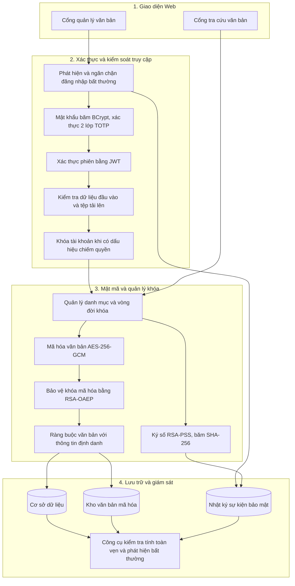
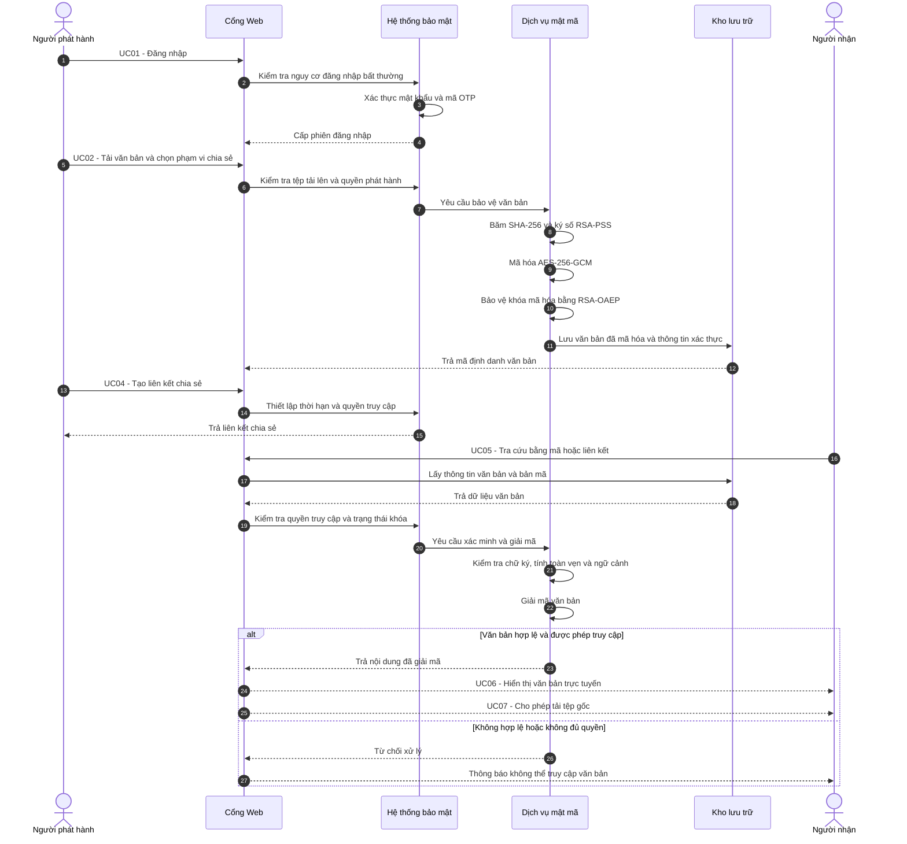

# Báo Cáo Đồ Án Bảo Mật Mạng Máy Tính Và Hệ Thống
## Đề Tài: Hệ Thống Lưu Trữ, Phát Hành Và Tra Cứu Văn Bản Điện Tử

---

## 1. Đặc Tả 2 Tác Nhân (Actors) & 7 Use Case Thuần Nghiệp Vụ 
### 1.1. Hai Tác nhân phần mềm (Actors)
1. **Người phát hành (Issuer / Đơn vị ban hành)**: Cán bộ quản lý đăng nhập vào cổng làm việc để tải lên văn bản mới, thiết lập phạm vi văn bản (`Công khai` hoặc `Nội bộ`), quản lý danh mục kho văn bản đã ban hành và tạo liên kết chia sẻ có thời hạn.
2. **Người nhận / Khách (Recipient / Public User)**: Sinh viên, đối tác hoặc nhân sự truy cập Cổng tra cứu khách mà không cần đăng nhập tài khoản để xem danh sách các văn bản **Công khai (`PUBLIC`)**, hoặc nhập đúng mã định danh / liên kết chia sẻ để mở các văn bản **Nội bộ (`PRIVATE`)**, xem trước nội dung trực tuyến và tải tệp gốc về máy.

### 1.2. Bảng 7 Use Case Nghiệp Vụ

| Mã UC | Tên Use Case | Tác nhân | Mô tả luồng nghiệp vụ chính |
| :--- | :--- | :--- | :--- |
| **UC01** | Đăng nhập hệ thống | Người phát hành | Cán bộ nhập tài khoản và mật khẩu để truy cập bảng điều khiển quản lý danh mục văn bản của đơn vị. |
| **UC02** | Tải lên và Lưu trữ văn bản mới | Người phát hành | Chọn tệp từ máy tính hoặc nhập nội dung, điền Tên văn bản, Cơ quan ban hành, chọn Phạm vi (`Công khai` / `Nội bộ`), nhập Mã xác nhận lưu trữ và bấm **Lưu trữ văn bản**; hệ thống cấp Mã định danh (`VB-2026-0001`, `VB-2026-0002`, ...). |
| **UC03** | Quản lý danh mục kho văn bản | Người phát hành | Xem bảng danh mục gồm: Mã định danh, Tên tệp, Cơ quan ban hành, Ngày ban hành, Kích thước, Phạm vi (`Công khai` / `Nội bộ`), Trạng thái phát hành (`Đã ban hành` / `Đang chia sẻ`) và lọc/tìm kiếm văn bản. |
| **UC04** | Tạo liên kết chia sẻ văn bản | Người phát hành | Chọn văn bản, thiết lập thời hạn hiệu lực (`15 phút`, `1 giờ`, `1 ngày`), sinh liên kết chia sẻ và sao chép gửi cho người nhận. |
| **UC05** | Mở và Tra cứu văn bản theo mã / liên kết | Người nhận / Khách | Chọn nhanh văn bản trong bảng **Danh sách văn bản công khai**, hoặc nhập mã định danh (`VB-2026-0001`, `VB-2026-0002`) / liên kết chia sẻ (`?share=...`) vào thanh tra cứu để mở cả văn bản công khai lẫn văn bản nội bộ. |
| **UC06** | Xem trước nội dung văn bản trực tuyến | Người nhận / Khách | Xem trực tiếp Mã định danh, Tên tệp, Cơ quan ban hành, Ngày ban hành và toàn bộ nội dung văn bản trên trình duyệt sau khi hệ thống xác thực tính toàn vẹn. |
| **UC07** | Tải tệp văn bản về máy tính | Người nhận / Khách | Bấm nút **Tải tệp về máy** tại khung xem trước để lưu tệp văn bản gốc về thiết bị cá nhân. |

### 1.3. Sơ Đồ Use Case Tổng Thể (`UC01 -> UC07`)

```planuml
@startuml
left to right direction
skinparam packageStyle rectangle
skinparam shadowing false

actor "Người phát hành" as Issuer
actor "Người nhận" as Recipient

rectangle "Hệ thống quản lý và chia sẻ kho văn bản" {
    usecase "UC01: Đăng nhập hệ thống" as UC01
    usecase "UC02: Tải lên và lưu trữ\nvăn bản mới" as UC02
    usecase "UC03: Quản lý danh mục\nkho văn bản" as UC03
    usecase "UC04: Tạo liên kết\nchia sẻ văn bản" as UC04
    usecase "UC05: Mở và tra cứu văn bản\ntheo mã hoặc liên kết" as UC05
    usecase "UC06: Xem trước nội dung\nvăn bản trực tuyến" as UC06
    usecase "UC07: Tải tệp văn bản\nvề máy tính" as UC07
    usecase "Cấp mã định danh\ncho văn bản" as UC08
    usecase "Xác thực quyền truy cập\nvà giải mã văn bản" as UC09
}

Issuer --> UC01
Issuer --> UC02
Issuer --> UC03
Issuer --> UC04

Recipient --> UC05
Recipient --> UC06
Recipient --> UC07

UC02 ..> UC08 : <<include>>
UC05 ..> UC09 : <<include>>
UC06 ..> UC09 : <<include>>
UC07 ..> UC09 : <<include>>


@enduml
```

---

## 2. Kiến Trúc Bảo Mật & Mật Mã Học Nâng Cao (Tích Hợp Từ Chương Trình Học & Thực Hành)

### 2.0. Sơ Đồ Cấu Trúc Hệ Thống & Sơ Đồ Trình Tự Nghiệp Vụ

#### a) Sơ đồ Cấu trúc Hệ thống & Bảo mật Đa tầng (System Architecture Diagram)



#### b) Sơ đồ Trình tự Luồng Phát hành, Chia sẻ & Tra cứu Văn bản (Sequence Diagram)



### 2.4. Quản trị Vòng đời Khóa (`Key Inventory` & `SPKI SHA-256 Fingerprint`)
- Hệ thống quản lý danh mục khóa mật mã tại bảng `key_inventory` và xuất tệp `data/key_inventory.csv` kèm dấu vân tay chuẩn **`fingerprint_sha256_spki`** (băm `SHA-256` trên cấu trúc DER `SPKI` của Public Key) với 3 trạng thái vòng đời:
  - `vault-rsa-prod-2026Q4` (`ACTIVE`): Khóa đang hoạt động hợp lệ.
  - `vault-rsa-retired-2026Q3` (`RETIRED`): Khóa đã ngưng sử dụng / thu hồi.
  - `vault-rsa-qa-2026Q4` (`QA_ONLY`): Khóa chỉ dùng cho môi trường kiểm thử.
- Khi giải mã hoặc xác thực văn bản, nếu `key_id` của hồ sơ nằm ở trạng thái `RETIRED` hoặc `QA_ONLY`, hệ thống từ chối ngay với mã lỗi `HTTP 422 KEY_NOT_ACTIVE`.

### 2.5. Xác thực Thích ứng Trước BCrypt (`Pre-BCrypt Risk-based Authentication`) & Công cụ SOC CLI
- **Bảo vệ tài nguyên CPU trước `BCrypt`**: Trước khi gọi hàm băm mật khẩu tốn CPU `bcrypt.compareSync()`, hệ thống chấm điểm rủi ro (`LOW` / `MEDIUM` / `HIGH`) theo địa chỉ IP trong khung cửa sổ trượt 10 phút:
  - Phát hiện **Brute-force** (`>= 4` lần đăng nhập thất bại liên tiếp từ 1 IP) hoặc **Password Spraying** (`1 IP` thử sai mật khẩu rải qua `>= 3` tài khoản khác nhau) -> Phân loại `HIGH_RISK` và chặn ngay lập tức (`HTTP 429 PRE_BCRYPT_BLOCKED`) trước khi chạm vào `BCrypt`.
- **Chuẩn hóa Nhật ký SOC & Baseline**:
  - Ghi nhận sự kiện xác thực ra tệp `data/auth_events.csv` và đối chiếu trạng thái toàn vẹn tại `data/hash_baseline.txt`.
  - Cung cấp công cụ dòng lệnh `npm run tool:soc` (`scripts/soc-detector.js`) phân tích log theo chuẩn `MITRE ATT&CK T1110` và `npm run tool:sha` (`scripts/sha-inspector.js`) đối chiếu `hash_baseline.txt` cùng `key_inventory.csv`.

### 2.6. Bảo vệ Đường truyền Mạng & Tăng Cường Bảo Mật 4 Lớp (`Zero-Trust 4-Layer Hardening`)
- **Đường hầm Mã hóa Hai chiều (`POST /api/zt-tunnel` + `ztEncryptedResponse`) & Chống Phát lại (`HMAC-SHA256`)**:
  - Mọi yêu cầu từ trình duyệt (`GET`, `POST`, `DELETE` và cả tải tệp `FormData`) đều được đóng gói `{ method, path, body }` (tệp nhị phân chuyển thành `__ztFile` Base64), mã hóa `AES-256-GCM` thành `ztEncryptedPayload` (`<ivHex12B>.<ciphertextBase64>.<authTagHex16B>`) và gửi qua cổng duy nhất `POST /api/zt-tunnel` kèm bộ 3 header chống phát lại (`X-ZT-Timestamp`, `X-ZT-Nonce`, `X-ZT-Signature` đối chiếu bằng `crypto.timingSafeEqual()`).
  - Toàn bộ JSON phản hồi từ máy chủ được mã hóa `AES-256-GCM` thành `ztEncryptedResponse`, giải mã ngầm trong `protectedFetch()`.
- **4 Lớp Gia cố Chống Dịch ngược, Chống Soi API & Chống Quét Từ điển**:
  1. **Lớp 1 — Mã hóa & Làm mờ Chuỗi Endpoint ở Frontend (`Runtime String Obfuscation`)**: Xóa bỏ hoàn toàn các chuỗi đường dẫn dạng rõ (`/api/...`) khỏi mã nguồn giao diện (`0 match` khi quét grep `/api/` trên `public/app.js`, `public/index.html`, `public/styles.css`), thay bằng bảng mã hóa `XOR 0x5A + Hex` (`_ZT_ENDPOINTS`) giải mã động lúc chạy (`resolveEndpoint()`).
  2. **Lớp 2 — Chế độ Bắt buộc Đường hầm (`Strict Zero-Trust Tunnel Mode - 404 Blackhole`)**: Chỉ chấp nhận gói tin hợp lệ đi qua `POST /api/zt-tunnel` kèm chữ ký `HMAC-SHA256` và `Timestamp`/`Nonce`. Mọi yêu cầu cố tình gọi thẳng vào các đường dẫn nghiệp vụ bên dưới (như `GET /api/documents/public` hay `POST /api/auth/login`) đều bị chặn và trả về đồng nhất `HTTP 404 Not Found` (Blackhole response).
  3. **Lớp 3 — Lá chắn Chống Gỡ lỗi & Chống Mở DevTools (`Anti-DevTools & Anti-Hooking Shield`)**: Chặn các phím tắt mở DevTools/View Source (`F12`, `Ctrl+Shift+I/J/C`, `Ctrl+U`) và menu chuột phải (`contextmenu`); đóng băng (`Object.freeze`) các đối tượng nhạy cảm (`window.crypto.subtle`, `JSON`) và kích hoạt bẫy `debugger` bất đồng bộ khi phát hiện mở khung DevTools.
  4. **Lớp 4 — Tự động Khóa IP Chống Quét Từ điển (`Anti-Fuzzing Guard - HTTP 429`)**: Nếu một địa chỉ IP gửi liên tiếp từ 10 yêu cầu sai định dạng hoặc gọi thẳng vào các đường dẫn bị chặn `404 Blackhole` trong vòng 1 phút, hệ thống tự động đưa IP đó vào danh sách đen tạm thời và chặn bằng mã lỗi `HTTP 429` (`ANTI_FUZZING_BLOCKED`).

---

## 3. Giải Đáp 5 Câu Hỏi Cốt Lõi Của Đề Bài

1. **Hệ thống đang bảo vệ tài sản hoặc dữ liệu gì?**
   - Bảo vệ tính bí mật, tính toàn vẹn và tính xác thực nguồn gốc của các văn bản, quyết định công khai và hợp đồng nội bộ lưu trữ trong kho (`storage/*.enc`), bảo vệ thông tin trao đổi trên đường truyền API (`ztEncryptedPayload` & `ztEncryptedResponse`), khóa dữ liệu `DEK`, khóa đóng gói `KEK`, khóa ký số của đơn vị ban hành, danh mục vòng đời khóa (`data/key_inventory.csv`), các liên kết chia sẻ và nhật ký kiểm toán (`audit_logs`, `data/auth_events.csv`, `data/hash_baseline.txt`).
2. **Ai sử dụng hệ thống và ai có thể tấn công hoặc lợi dụng hệ thống?**
   - **Người sử dụng hợp lệ**: **Người phát hành** (`UC01 -> UC04`) và **Người nhận / Khách** (`UC05 -> UC07`).
   - **Kẻ tấn công**: Kẻ tấn công bên ngoài dò/rải mật khẩu (Brute-force / Password Spraying), bắt gói tin trên trình duyệt để soi cấu trúc API hoặc phát lại yêu cầu (Replay Attack), phát tán tệp độc hại `.exe`/XSS; kẻ xâm nhập máy chủ sửa đổi byte tệp lưu trữ, đánh tráo ngữ cảnh `AAD`, ký đè văn bản bằng khóa giả mạo hoặc dùng khóa đã thu hồi (`RETIRED`); kẻ chiếm quyền phiên đăng nhập của cán bộ phát hành.
3. **Những rủi ro hoặc cách tấn công nào có thể xảy ra?**
   - Nghe lén hoặc soi dữ liệu JSON/đường dẫn API trên DevTools, bắt và phát lại gói tin mạng (Replay Attack), sửa đổi trái phép nội dung tệp trên đĩa (Tampering 1-byte), giả mạo chữ ký số (Signature Forgery), hoán đổi ngữ cảnh bản mã giữa các hồ sơ (Context-Swapping Attack), sử dụng khóa hết hiệu lực (`RETIRED` / `QA_ONLY`), tấn công Brute-force & Password Spraying làm cạn kiệt CPU của `BCrypt`, tải lên tệp thực thi độc hại / kịch bản XSS, dùng lại liên kết chia sẻ đã hết hạn, và chiếm quyền tài khoản (Account Takeover).
4. **Hệ thống sử dụng cơ chế nào để bảo vệ?**
   - Kết hợp đa tầng: Đường hầm mã hóa hai chiều `Zero-Trust Two-Way Encrypted Tunnel` (`POST /api/zt-tunnel` + `ztEncryptedResponse` bằng `AES-256-GCM`) kết hợp chống phát lại `HMAC-SHA256` (`X-ZT-Timestamp`, `X-ZT-Nonce`, `X-ZT-Signature`), mã hóa phong bì lai (`DEK AES-256-GCM` 32B ngẫu nhiên + `KEK RSA-OAEP-SHA256`), ràng buộc ngữ cảnh `AAD`, chữ ký số `RSA-PSS` 2048-bit, đối chiếu `SHA-256` bằng `crypto.timingSafeEqual()`, quản lý vòng đời khóa `Key Inventory` (`SPKI SHA-256 Fingerprint`), sàng lọc rủi ro trước `BCrypt` (`Pre-BCrypt Risk Triage`), xác thực `2FA TOTP`, Mã xác nhận lưu trữ cấp 2 và bộ công cụ giám sát `SOC Detector` (`MITRE ATT&CK T1110`).
5. **Nếu thông tin đầu vào bị giả mạo hoặc tài khoản bị chiếm quyền thì hệ thống xử lý như thế nào?**
   - **Khi gói tin đường truyền, thông tin đầu vào hoặc bản mã/chữ ký/ngữ cảnh AAD bị giả mạo**: Hệ thống chặn ngay gói tin sai chữ ký HMAC hoặc phát lại (`HTTP 401` / `HTTP 409`), từ chối lưu trữ tệp độc hại (`HTTP 400`) hoặc ngắt giải mã và chặn tải xuống ngay lập tức (`HTTP 422`), hiển thị thông báo từ chối truy cập trên giao diện và ghi nhận vào nhật ký kiểm toán.
   - **Khi tài khoản bị chiếm quyền (nhập sai mã xác nhận lưu trữ quá 3 lần hoặc tấn công dò mật khẩu vượt ngưỡng)**: Hệ thống chặn sớm trước `BCrypt` (`HTTP 429 PRE_BCRYPT_BLOCKED`) hoặc tự động khóa khẩn cấp chức năng tải lên & chia sẻ của tài khoản (`HTTP 423 ACCOUNT_COMPROMISED_LOCKED`), đồng thời thu hồi toàn bộ liên kết chia sẻ đang mở (`HTTP 403 LINK_REVOKED_ACCOUNT_TAKEOVER`).

---

## 4. Ma Trận Kiểm Thử Bảo Mật Tự Động (`28/28` Ca Đạt — `tests/security.test.js`)

| STT | Mã ca | Nội dung kiểm thử | Điều kiện & Kết quả thực tế |
| :--- | :--- | :--- | :--- |
| 1 | **Unit Crypto** | Kiểm tra lõi mật mã `node:crypto` | `SHA-256` (`timingSafeEqual`), `RSA-2048` Sign/Verify, `AES-256-GCM` (IV 12B duy nhất, AuthTag 16B), `TOTP RFC 6238` -> **ĐẠT** |
| 2 | **TC01** | Ký số & Mã hóa lưu trữ hợp lệ (Happy Path) | Tải tệp lên, lưu bản mã `.enc` trên đĩa (không chứa bản rõ) -> `HTTP 201` -> **ĐẠT** |
| 3 | **TC02** | Kiểm chứng tài liệu nguyên bản | Đối chiếu AuthTag, SHA-256 và chữ ký RSA-PSS -> `HTTP 200 GREEN` -> **ĐẠT** |
| 4 | **TC03** | Tấn công sửa 1 byte tệp đối chiếu (Client Tampering) | Sửa 1 byte tệp tải lên -> `HTTP 422 INTEGRITY_VIOLATION` -> **ĐẠT** |
| 5 | **TC04** | Tấn công sửa 1 byte tệp trong kho (Storage Tampering) | Sửa 1 byte tệp `.enc` trên đĩa -> `HTTP 422 STORAGE_TAMPERED` -> **ĐẠT** |
| 6 | **TC05** | Tấn công giả mạo chữ ký số (Signature Forgery) | Ký đè bằng khóa của `mallory_attacker` -> `HTTP 422 SIGNATURE_FORGED` -> **ĐẠT** |
| 7 | **TC06** | Truy cập liên kết chia sẻ hợp lệ | Mở bằng token còn hạn -> `HTTP 200` & giải mã khớp bản gốc -> **ĐẠT** |
| 8 | **TC07** | Truy cập liên kết chia sẻ đã hết hạn | Mở bằng token quá hạn -> `HTTP 403 LINK_EXPIRED` -> **ĐẠT** |
| 9 | **TC08** | Xác thực 2FA TOTP sai hoặc giả mạo | Nhập mã OTP sai `000000` -> `HTTP 401 INVALID_TOTP` -> **ĐẠT** |
| 10 | **TC09** | Chống vét cạn mã 2FA (Brute-force Rate Limit) | Nhập sai OTP quá 5 lần -> `HTTP 429 TOO_MANY_ATTEMPTS` -> **ĐẠT** |
| 11 | **TC10** | Truy cập API phát hành không có JWT hoặc JWT giả | Không gửi token hoặc sửa JWT -> `HTTP 401 UNAUTHORIZED` -> **ĐẠT** |
| 12 | **TC11** | Kiểm thử biên tệp rỗng (BVA Min = 0 byte) | Tải tệp `0 byte` -> `HTTP 400 EMPTY_OR_MISSING_FILE` -> **ĐẠT** |
| 13 | **TC12** | Kiểm thử biên tệp vượt ngưỡng (BVA Max > 10MB) | Tải tệp `> 10MB` -> `HTTP 413 FILE_TOO_LARGE` -> **ĐẠT** |
| 14 | **TC13** | Chặn đầu vào giả mạo (`.exe` & XSS `<script>`) | Tải tệp `.exe` hoặc chèn `<script>` -> `HTTP 400 MALICIOUS_OR_FORGED_INPUT` -> **ĐẠT** |
| 15 | **TC14** | Chặn ký số khi nhập sai Mã xác nhận lưu trữ (PIN) | Nhập sai PIN lần 1 -> `HTTP 403 INVALID_SIGNING_PIN` -> **ĐẠT** |
| 16 | **TC15** | Tự động khóa tài khoản & thu hồi link khi bị chiếm quyền | Nhập sai PIN đủ 3 lần -> `HTTP 423 ACCOUNT_COMPROMISED_LOCKED` & thu hồi link (`HTTP 403`) -> **ĐẠT** |
| 17 | **TC16** | Phân loại văn bản `PUBLIC` và `PRIVATE` | Ẩn `PRIVATE` khỏi `/api/documents/public`, chỉ mở khi tra cứu đúng mã/link -> **ĐẠT** |
| 18 | **TC17** | Mã hóa phong bì lai `DEK` + `KEK` (`RSA-OAEP-SHA256`) | Kiểm tra `wrappedDekBase64` và `aadBase64` gắn với khóa `vault-rsa-prod-2026Q4` -> **ĐẠT** |
| 19 | **TC18** | Chống tấn công hoán đổi ngữ cảnh `AAD` (Context-Swapping) | Tráo `aad_b64` sang hồ sơ khác -> `HTTP 422 AAD_CONTEXT_MISMATCH` -> **ĐẠT** |
| 20 | **TC19** | Quản trị vòng đời khóa `Key Inventory` (`SPKI SHA-256`) | Đổi trạng thái khóa sang `RETIRED` -> `HTTP 422 KEY_NOT_ACTIVE` -> **ĐẠT** |
| 21 | **TC20** | Chặn Brute-force trước `BCrypt` (`Pre-BCrypt Risk Triage`) | 1 IP sai mật khẩu `>= 4` lần -> Lần thứ 5 bị chặn ngay `HTTP 429 PRE_BCRYPT_BLOCKED` -> **ĐẠT** |
| 22 | **TC21** | Chặn Password Spraying trước `BCrypt` | 1 IP thử sai mật khẩu trên `>= 3` tài khoản -> `HTTP 429 PRE_BCRYPT_BLOCKED` -> **ĐẠT** |
| 23 | **TC22** | Tải lên tệp Word (`.docx`), trích xuất xem trước & tải tệp gốc | Trích xuất HTML/Text xem trước, bảo toàn 100% byte nhị phân `.docx` khi tải về -> **ĐẠT** |
| 24 | **TC23** | Tùy chọn thời hạn liên kết chia sẻ dài hạn | Tạo liên kết chia sẻ với thời hạn `7 ngày`, `30 ngày`, `90 ngày`, `1 năm` -> `HTTP 201` -> **ĐẠT** |
| 25 | **TC24** | Xóa văn bản khỏi kho (`DELETE /api/documents/:id`) | Xóa bản ghi DB, thu hồi liên kết chia sẻ và xóa tệp `.enc` trên đĩa -> `HTTP 200` -> **ĐẠT** |
| 26 | **TC25** | Xác nhận gỡ bỏ hoàn toàn các route giả lập nội bộ | Gọi các đường dẫn cũ `/api/attack/*` -> Trả về `HTTP 404 Not Found` -> **ĐẠT** |
| 27 | **TC26** | Đường hầm Mã hóa Hai chiều (`POST /api/zt-tunnel` + `ztEncryptedResponse`) & Chống Replay (`HMAC-SHA256`) | Bọc `POST` & `GET` qua `/api/zt-tunnel`, phản hồi `ztEncryptedResponse` mã hóa `AES-256-GCM`; chặn Replay Nonce (`HTTP 409`), Timestamp quá hạn (`HTTP 401`) và chữ ký HMAC giả (`HTTP 401`) -> **ĐẠT** |
| 28 | **TC27** | Tăng cường Bảo mật 4 Lớp (String Obfuscation, 404 Blackhole, Anti-DevTools Shield, Anti-Fuzzing HTTP 429) | `0 match` chuỗi `/api/` ở Frontend; gọi thẳng ngoài tunnel trả về `404 Blackhole`; kích hoạt `initSecurityShield` & `Object.freeze`; quét từ điển `>= 10` lần/phút bị khóa IP `HTTP 429 ANTI_FUZZING_BLOCKED` -> **ĐẠT** |

