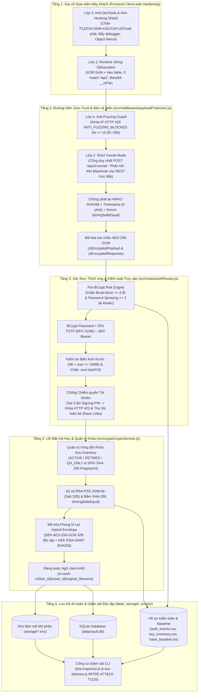
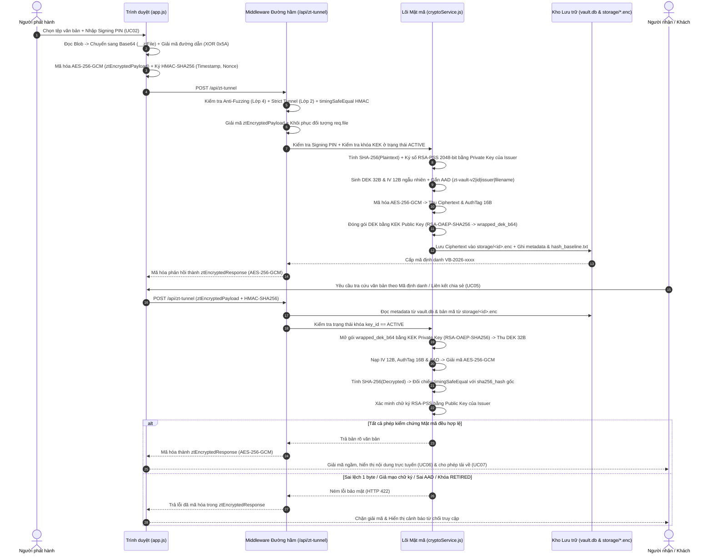
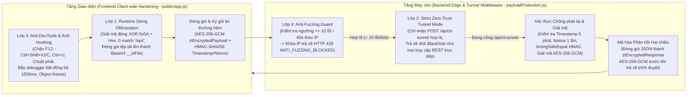

# Phương Pháp Bảo Mật & Mật Mã Học — Hệ Thống Cổng Văn Bản & Hồ Sơ Điện Tử

> **Báo cáo Chuyên sâu Kiến trúc An toàn Thông tin, Mật mã Phong bì Lai, Hệ thống Phòng thủ 4 Lớp & Kiểm chứng Nghiệm thu**
> *(Xem thêm: [README.md](file:///D:/University/Y4-5%20Bao%20Mat%20May%20Tinh%20Va%20HT/DACK/README.md) để xem hướng dẫn cài đặt | [TAI_LIEU_PHAN_MEM.md](file:///D:/University/Y4-5%20Bao%20Mat%20May%20Tinh%20Va%20HT/DACK/TAI_LIEU_PHAN_MEM.md) để xem đặc tả 7 Use Case nghiệp vụ và thiết kế cơ sở dữ liệu).*

---

## 1. Giải Đáp Trực Diện 5 Câu Hỏi Cốt Lõi Của Đề Bài

### Câu 1: Hệ thống đang bảo vệ tài sản hoặc dữ liệu gì?
1. **Nội dung văn bản và hồ sơ điện tử** (quyết định công nhận tốt nghiệp, bảng điểm, hợp đồng ngân sách nội bộ) lưu trữ trong kho `storage/*.enc` — đảm bảo tính bí mật (Confidentiality), tính toàn vẹn (Integrity) và tính xác thực nguồn gốc chống chối bỏ (Authenticity & Non-repudiation).
2. **Dữ liệu trao đổi hai chiều trên đường truyền mạng và cấu trúc điểm cuối API**: Bảo vệ các đường dẫn API ở tầng giao diện (`_ZT_ENDPOINTS`) khỏi bị dò quét tĩnh, đồng thời bảo vệ toàn bộ gói tin yêu cầu (`ztEncryptedPayload`) và gói tin phản hồi (`ztEncryptedResponse`) đi qua đường hầm `/api/zt-tunnel`.
3. **Hệ thống khóa mật mã của đơn vị phát hành**: Khóa dữ liệu đối xứng `DEK` (`AES-256-GCM` 32 bytes sinh độc lập cho từng văn bản), khóa đóng gói bất đối xứng `KEK` (`RSA-OAEP-SHA256`), khóa ký số `RSA-2048` (`RSA-PSS`) và danh mục vòng đời khóa `key_inventory` (`data/key_inventory.csv`).
4. **Danh tính tài khoản cán bộ phát hành, phiên làm việc, liên kết chia sẻ có thời hạn và hồ sơ kiểm toán SOC (`audit_logs`, `data/auth_events.csv`, `data/hash_baseline.txt`)**.

### Câu 2: Ai sử dụng hệ thống và ai có thể tấn công hoặc lợi dụng hệ thống?
- **Người sử dụng hợp lệ**:
  - **Người phát hành (`Issuer`)**: Cán bộ quản lý đăng nhập, ký số, mã hóa lưu trữ văn bản mới và cấp liên kết chia sẻ (`UC01 -> UC04`).
  - **Người nhận / Khách (`Recipient / Public User`)**: Người dùng tra cứu văn bản công khai hoặc mở văn bản nội bộ qua mã định danh / liên kết chia sẻ, xem trực tuyến và tải tệp gốc (`UC05 -> UC07`).
- **Đối tượng tấn công hoặc lợi dụng hệ thống**:
  - **Kẻ tấn công bề mặt giao diện & đường truyền (Client-side & Network Attacker)**: Dịch ngược mã nguồn JavaScript phía máy khách để thu thập danh sách API (`grep /api/`), mở F12 DevTools để gỡ lỗi hoặc gắn móc (hooking/monkey-patching) vào hàm mật mã trên trình duyệt, bắt gói tin mạng để phát lại (Replay Attack), hoặc chạy công cụ fuzzing tự động (`ffuf`, `gobuster`, `wfuzz`) để dò quét đường dẫn.
  - **Kẻ tấn công bên ngoài vào cổng xác thực & đầu vào (External Attacker)**: Thực hiện vét cạn mật khẩu (Brute-force), rải mật khẩu trên nhiều tài khoản (Password Spraying) nhằm làm cạn kiệt tài nguyên CPU của hàm `BCrypt`, hoặc tải lên tệp thực thi độc hại (`.exe`, `.bat`, `.ps1`) và chèn mã kịch bản XSS (`<script>`).
  - **Kẻ tấn công nội gián hoặc xâm nhập máy chủ (Malicious Insider / Compromised Host)**: Sửa đổi trực tiếp 1 byte trên tệp bản mã `storage/*.enc`, hoán đổi bản mã và ngữ cảnh giữa hai hồ sơ văn bản (Context-Swapping Attack), ký đè văn bản bằng khóa giả mạo (`mallory_attacker`), hoặc cố tình sử dụng khóa đã thu hồi (`RETIRED`).
  - **Kẻ chiếm quyền phiên làm việc (Session Hijacker)**: Đánh cắp phiên đăng nhập của cán bộ phát hành để phát hành văn bản giả mạo hoặc phát tán liên kết chia sẻ trái phép.

### Câu 3: Những rủi ro hoặc cách tấn công nào có thể xảy ra?
1. **Rủi ro lộ cấu trúc API và can thiệp luồng chạy phía trình duyệt**: Quét tĩnh mã nguồn tìm chuỗi `/api/...`, mở DevTools sửa đổi dữ liệu trước khi mã hóa hoặc đọc trộm JSON phản hồi trên tab Network.
2. **Tấn công phát lại gói tin (Replay Attack) và dò quét từ điển API (Directory/Endpoint Fuzzing)**.
3. **Tấn công can thiệp dữ liệu lưu trữ hoặc tệp đối chiếu (Tampering 1-byte)**: Làm sai lệch nội dung văn bản sau khi đã ban hành.
4. **Tấn công giả mạo chữ ký số (Signature Forgery)**: Mạo danh cơ quan ban hành bằng cặp khóa bất đối xứng khác.
5. **Tấn công hoán đổi ngữ cảnh bản mã (Context-Swapping Attack)**: Đánh tráo tệp `.enc` hoặc siêu dữ liệu `aad_b64` giữa hai hồ sơ văn bản.
6. **Lạm dụng khóa hết hiệu lực (Key Lifecycle Violation)**: Giải mã hoặc xác thực văn bản gắn với khóa đã bị thu hồi (`RETIRED`) hoặc khóa chỉ dành cho kiểm thử (`QA_ONLY`).
7. **Tấn công Brute-force & Password Spraying**: Gửi hàng loạt yêu cầu xác thực sai làm nghẽn CPU bởi phép băm `BCrypt` hoặc dò mã 2FA TOTP.
8. **Tấn công đầu vào giả mạo (Input Forgery / Malicious Upload)**: Đưa tệp thực thi độc hại hoặc mã XSS vào kho lưu trữ.
9. **Chiếm quyền tài khoản (Account Takeover) & Lạm dụng liên kết chia sẻ đã hết hạn (Expired Link Replay)**.

### Câu 4: Hệ thống sử dụng cơ chế nào để bảo vệ?
Hệ thống triển khai kiến trúc bảo vệ đa tầng khép kín:
- **Tầng Giao diện & Hệ thống Phòng thủ 4 Lớp (`Zero-Trust 4-Layer Hardening`)**:
  - **Lớp 1 (`Runtime String Obfuscation` & Base64 File Packing)**: Mã hóa toàn bộ chuỗi đường dẫn API bằng `XOR 0x5A + Hex` (`0 match` `/api/` khi quét tĩnh) và đóng gói tệp tải lên dạng Base64 (`__ztFile`) bên trong đường hầm mã hóa.
  - **Lớp 2 (`Strict Zero-Trust Tunnel Mode` & `404 Blackhole`)**: Chỉ nhận yêu cầu qua cổng duy nhất `POST /api/zt-tunnel` kèm mã hóa hai chiều `AES-256-GCM` (`ztEncryptedPayload` & `ztEncryptedResponse`) và chữ ký chống phát lại `HMAC-SHA256` + `Timestamp`/`Nonce` đối chiếu bằng `crypto.timingSafeEqual()`; trả về `HTTP 404 Not Found` (`404 Blackhole`) cho mọi truy cập REST trực tiếp.
  - **Lớp 3 (`Anti-DevTools & Anti-Hooking Shield`)**: Chặn phím tắt `F12`, `Ctrl+Shift+I/J/C`, `Ctrl+U`, chuột phải `contextmenu`, kích hoạt bẫy `debugger` bất đồng bộ làm đóng băng luồng khi cố mở Console, và đóng băng `Object.freeze` cho `window.crypto.subtle` cùng `JSON`.
  - **Lớp 4 (`Anti-Fuzzing Guard`)**: Tự động khóa IP và trả về `HTTP 429 ANTI_FUZZING_BLOCKED` khi vượt ngưỡng 10 lỗi vi phạm trong vòng 60 giây.
- **Tầng Mật mã học (`node:crypto`)**: Mã hóa phong bì lai **Hybrid Envelope Encryption** (`DEK AES-256-GCM` 32 bytes ngẫu nhiên cho từng tệp + `KEK RSA-OAEP-SHA256`), ràng buộc ngữ cảnh **AAD (`Additional Authenticated Data`)**, băm **SHA-256** đối chiếu hằng thời gian `crypto.timingSafeEqual()`, chữ ký số **RSA-PSS 2048-bit**, và quản lý vòng đời khóa **Key Inventory** (`ACTIVE` / `RETIRED` / `QA_ONLY`) kèm dấu vân tay chuẩn **SPKI SHA-256**.
- **Tầng Kiểm soát Truy cập & Giám sát SOC**: Sàng lọc rủi ro thích ứng **trước BCrypt (`Pre-BCrypt Risk Triage`)**, xác thực đa yếu tố **2FA TOTP (RFC 6238)**, kiểm tra **Mã xác nhận lưu trữ cấp 2 (`Signing PIN`)**, bộ lọc tệp độc hại/XSS, và bộ công cụ giám sát độc lập (`sha-inspector.js`, `soc-detector.js` theo `MITRE ATT&CK T1110`).

### Câu 5: Nếu thông tin đầu vào bị giả mạo hoặc tài khoản bị chiếm quyền thì hệ thống xử lý như thế nào?
- **Khi có hành vi gọi thẳng REST API ngoài đường hầm hoặc dò quét tự động**:
  - Hệ thống trả về `HTTP 404 Not Found` (`404 Blackhole`) để ẩn toàn bộ bề mặt API; nếu một địa chỉ IP tích lũy từ 10 lỗi vi phạm trở lên trong vòng 60 giây, hệ thống tự động phong tỏa IP đó với mã `HTTP 429 ANTI_FUZZING_BLOCKED`.
- **Khi gói tin đường truyền, thông tin đầu vào hoặc bản mã/chữ ký/ngữ cảnh AAD/khóa bị giả mạo**:
  - Hệ thống chặn ngay gói tin sai chữ ký HMAC, quá hạn thời gian 5 phút hoặc phát lại Nonce (`HTTP 401` / `HTTP 409`), từ chối lưu trữ tệp độc hại (`HTTP 400 MALICIOUS_OR_FORGED_INPUT`), hoặc lập tức ngắt giải mã và chặn tải xuống (`HTTP 422 STORAGE_TAMPERED` / `SIGNATURE_FORGED` / `AAD_CONTEXT_MISMATCH` / `KEY_NOT_ACTIVE` / `INTEGRITY_VIOLATION`), hiển thị thông báo cảnh báo bảo mật trên giao diện và ghi vết mức `CRITICAL` vào `audit_logs`.
- **Khi tài khoản bị tấn công dò mật khẩu hoặc bị chiếm quyền (Account Takeover)**:
  - Nếu dò mật khẩu (`>= 4` lần sai từ 1 IP) hoặc rải mật khẩu (`>= 3` tài khoản từ 1 IP), hệ thống chặn sớm trước khi gọi `BCrypt` (`HTTP 429 PRE_BCRYPT_BLOCKED`) và ghi vào `data/auth_events.csv`.
  - Nếu kẻ tấn công chiếm được phiên JWT và nhập sai `Mã xác nhận lưu trữ (Signing PIN)` 3 lần liên tiếp khi cố phát hành văn bản, hệ thống tự động kích hoạt **Khóa khẩn cấp tài khoản (`HTTP 423 ACCOUNT_COMPROMISED_LOCKED`)**, vô hiệu hóa toàn bộ quyền tải lên và chia sẻ của tài khoản đó, đồng thời **thu hồi tức thì mọi liên kết chia sẻ đang mở (`HTTP 403 LINK_REVOKED_ACCOUNT_TAKEOVER`)**.

---

## 2. Kiến Trúc Bảo Mật Đa Tầng & Giải Pháp Mật Mã Học Nâng Cao

### 2.1. Sơ Đồ Kiến Trúc Bảo Mật Đa Tầng & Trình Tự Xử Lý Mật Mã

#### a) Sơ đồ Kiến trúc Bảo mật 5 Tầng (Defense-in-Depth Architecture)



#### b) Sơ đồ Trình tự Mật mã Luồng Phát hành & Kiểm chứng Văn bản



### 2.2. Mã Hóa Phong Bì Lai (`Hybrid Envelope Encryption`: `DEK AES-256-GCM` + `KEK RSA-OAEP-SHA256`)
- **Tách biệt Khóa dữ liệu (`DEK`) và Khóa đóng gói (`KEK`)**:
  - Khi lưu trữ một văn bản mới, hệ thống sinh một Khóa dữ liệu đối xứng (`Data Encryption Key - DEK`) dài 32 bytes (256-bit) hoàn toàn ngẫu nhiên bằng `crypto.randomBytes(32)` và một vector khởi tạo `IV` dài 12 bytes (`crypto.randomBytes(12)`) duy nhất cho văn bản đó.
  - Nội dung văn bản được mã hóa bằng thuật toán `AES-256-GCM`, sinh ra bản mã nhị phân (`ciphertext`) lưu vào `storage/<id>.enc` và thẻ xác thực tính toàn vẹn `Auth Tag` dài 16 bytes (`auth_tag_hex`).
  - Khóa `DEK` sau đó được đóng gói (wrap) bằng Khóa công khai `RSA-2048` của hệ thống (`Key Encryption Key - KEK`) sử dụng lược đồ đệm `RSA_PKCS1_OAEP_PADDING` với hàm băm `SHA-256` (`oaepHash: 'sha256'`), tạo thành chuỗi `wrapped_dek_b64` lưu trong cơ sở dữ liệu. Khóa `DEK` dạng rõ bị hủy ngay sau khi hoàn tất mã hóa.
- **Ưu điểm bảo mật**: Mỗi tệp văn bản có một khóa `DEK` và `IV` hoàn toàn khác nhau; tệp trên đĩa `storage/*.enc` chỉ chứa dữ liệu nhị phân đã mã hóa, không chứa bất kỳ chuỗi văn bản gốc nào.

### 2.3. Ràng Buộc Ngữ Cảnh Bằng Dữ Liệu Xác Thực Bổ Sung (`Additional Authenticated Data - AAD`)
- Để chống lại tấn công hoán đổi ngữ cảnh bản mã (**Context-Swapping Attack** — kẻ tấn công có quyền truy cập ổ đĩa hoặc cơ sở dữ liệu đánh tráo tệp `.enc` của văn bản A sang hồ sơ của văn bản B), hệ thống xây dựng chuỗi ngữ cảnh định danh:
  `zt-vault-v2|<document_id>|<issuer_id>|<original_filename>`
- Chuỗi ngữ cảnh này được nạp vào bộ mã hóa và giải mã `AES-256-GCM` thông qua `cipher.setAAD(aadBuffer)` và `decipher.setAAD(aadBuffer)`.
- Nếu bất kỳ thành phần nào trong ngữ cảnh (`document_id`, `issuer_id`, `original_filename`) hoặc chuỗi `aad_b64` bị tráo đổi, phép xác thực thẻ `Auth Tag` của `AES-256-GCM` sẽ lập tức thất bại và hệ thống ngắt giải mã với mã lỗi `HTTP 422 AAD_CONTEXT_MISMATCH`.

### 2.4. Chữ Ký Số `RSA-PSS` 2048-bit & Đối Chiếu Mã Băm Hằng Thời Gian (`timingSafeEqual`)
- **Băm toàn vẹn `SHA-256`**: Mỗi văn bản trước khi mã hóa được tính mã băm `SHA-256` (64 ký tự Hex) và ghi nhận đồng thời vào cột `sha256_hash` cùng tệp đối chiếu độc lập `data/hash_baseline.txt`.
- **Ký số xác suất `RSA-PSS`**: Hệ thống sử dụng khóa bí mật `RSA-2048` của đơn vị phát hành để ký lên dữ liệu văn bản theo chuẩn `RSA-PSS` (`crypto.constants.RSA_PKCS1_PSS_PADDING`, hàm băm `SHA-256`, độ dài `saltLength = 32` bytes). So với `RSA-PKCS1-v1_5` truyền thống, `RSA-PSS` bổ sung thành phần muối ngẫu nhiên giúp chống lại các tấn công chọn bản rõ và tăng cường tính an toàn toán học.
- **Chống tấn công kênh kề thời gian (`Timing Side-Channel Protection`)**: Mọi phép so sánh chuỗi mã băm `SHA-256` và chữ ký `HMAC-SHA256` trong hệ thống đều tuyệt đối không dùng toán tử `===` mà chuyển sang vùng đệm `Buffer` có độ dài bằng nhau và gọi hàm `crypto.timingSafeEqual(bufA, bufB)` để thời gian thực thi luôn không đổi.

### 2.5. Quản Trị Vòng Đời Khóa (`Key Inventory`) & Dấu Vân Tay Chuẩn `SPKI SHA-256`
- Hệ thống trích xuất cấu trúc khóa công khai theo chuẩn `SubjectPublicKeyInfo (SPKI)` ở định dạng nhị phân `DER` và băm `SHA-256` để tạo dấu vân tay định danh khóa bất biến (`fingerprint_sha256_spki`).
- Bảng `key_inventory` (và tệp xuất `data/key_inventory.csv`) duy trì 3 trạng thái vòng đời khóa:
  - `vault-rsa-prod-2026Q4` (`ACTIVE`): Khóa sản xuất đang hoạt động hợp lệ.
  - `vault-rsa-retired-2026Q3` (`RETIRED`): Khóa thế hệ cũ đã ngừng sử dụng / thu hồi.
  - `vault-rsa-qa-2026Q4` (`QA_ONLY`): Khóa chỉ được phép dùng trong môi trường kiểm thử.
- Trước mọi thao tác mở gói khóa hoặc xác thực văn bản, hệ thống truy vấn trạng thái của `key_id` gắn với văn bản đó; nếu trạng thái khác `ACTIVE` (`RETIRED` hoặc `QA_ONLY`), hệ thống lập tức chặn truy cập và trả về mã lỗi `HTTP 422 KEY_NOT_ACTIVE`.

---

## 3. Bảo Mật Ở Tầng Giao Diện (Frontend / Client-side Security Hardening) & Hệ Thống Phòng Thủ 4 Lớp

Để bảo vệ ứng dụng trước các kỹ thuật dịch ngược mã nguồn phía trình duyệt, soi luồng dữ liệu trên công cụ Developer Tools, phát lại gói tin và dò quét đường dẫn tự động, hệ thống triển khai kiến trúc **Phòng thủ 4 Lớp (`Zero-Trust 4-Layer Hardening`)** phối hợp giữa [public/app.js](file:///D:/University/Y4-5%20Bao%20Mat%20May%20Tinh%20Va%20HT/DACK/public/app.js) và [src/middleware/payloadProtection.js](file:///D:/University/Y4-5%20Bao%20Mat%20May%20Tinh%20Va%20HT/DACK/src/middleware/payloadProtection.js).

### 3.1. Sơ Đồ Luồng Hoạt Động Của Hệ Thống Phòng Thủ 4 Lớp



### 3.2. Lớp 1 — Mã Hóa & Làm Mờ Chuỗi Endpoint Ở Tầng Giao Diện (`Runtime String Obfuscation` & Đóng Gói Tệp `Base64`)

1. **Làm mờ chuỗi đường dẫn bằng phép toán `XOR 0x5A + Hex` (`_ZT_ENDPOINTS`)**:
   - Toàn bộ chuỗi đường dẫn `/api/...` dạng rõ đã bị loại bỏ triệt để khỏi mã nguồn tĩnh của tầng giao diện (`public/app.js`, `public/index.html`, `public/styles.css`). Khi quét tĩnh bằng công cụ tìm kiếm chuỗi `/api/` trên toàn bộ thư mục `public/`, kết quả trả về là **0 kết quả (`0 match`)**.
   - Các đường dẫn được mã hóa trước bằng phép toán logic `XOR` từng byte với khóa `_ZT_XOR_KEY = 0x5A` và lưu dưới dạng chuỗi thập lục phân (Hex) trong bảng hằng số bất biến `_ZT_ENDPOINTS = Object.freeze({...})`. Khi thực thi, hàm `resolveEndpoint(hexEncoded)` mới giải mã động trong bộ nhớ RAM:

| Định danh trong `_ZT_ENDPOINTS` | Chuỗi mã hóa Hex (`XOR 0x5A`) lưu trong mã nguồn | Đường dẫn giải mã động lúc chạy | Chức năng định tuyến bên trong đường hầm |
| :--- | :--- | :--- | :--- |
| `TUNNEL` | `753b2a3375202e772e2f34343f36` | `/api/zt-tunnel` | Cổng đường hầm mã hóa duy nhất tiếp nhận mọi yêu cầu |
| `AUTH_LOGIN` | `753b2a33753b2f2e327536353d3334` | `/api/auth/login` | Xác thực mật khẩu cán bộ và sàng lọc rủi ro trước BCrypt |
| `AUTH_VERIFY_2FA` | `753b2a33753b2f2e32752c3f28333c2377683c3b` | `/api/auth/verify-2fa` | Xác thực mã 2FA TOTP và cấp phiên làm việc JWT |
| `DOCS_ROOT` | `753b2a33753e35392f373f342e29` | `/api/documents` | Truy vấn danh mục kho văn bản của đơn vị và xóa văn bản |
| `DOCS_PUBLIC` | `753b2a33753e35392f373f342e29752a2f38363339` | `/api/documents/public` | Truy vấn danh sách văn bản công khai (`PUBLIC`) |
| `DOCS_SIGN` | `753b2a33753e35392f373f342e297529333d34` | `/api/documents/sign` | Tải lên, ký số `RSA-PSS` và mã hóa phong bì lai |
| `DOCS_EXTRACT_PREVIEW` | `753b2a33753e35392f373f342e29753f222e283b392e772a283f2c333f2d` | `/api/documents/extract-preview` | Trích xuất nội dung xem trước từ tệp tải lên (`.docx`/`.txt`) |
| `DOCS_LOOKUP_PREFIX` | `753b2a33753e35392f373f342e2975363535312f2a75` | `/api/documents/lookup/` | Tiền tố tra cứu văn bản theo mã định danh (`VB-2026-xxxx`) |
| `DOCS_SHARE_PREFIX` | `753b2a33753e35392f373f342e297529323b283f75` | `/api/documents/share/` | Tiền tố mở văn bản qua mã liên kết chia sẻ |
| `SHARE_SUFFIX` | `7529323b283f` | `/share` | Hậu tố khởi tạo liên kết chia sẻ có thời hạn |

2. **Đóng gói tệp tải lên dạng `Base64` (`__ztFile`) bên trong đường hầm mã hóa**:
   - Khi người dùng tải tệp qua đối tượng `FormData`, hàm `protectedFetch()` không gửi `multipart/form-data` dạng rõ mà tự động đọc luồng byte nhị phân qua `Blob.arrayBuffer()`, chuyển đổi theo từng khối 32KB (`0x8000`) trong hàm `uint8ToBase64()` sang chuỗi `Base64` và đóng gói vào trường `__ztFile`:
     ```json
     {
       "fieldname": "file",
       "originalname": "Hop_Dong_2026.docx",
       "mimetype": "application/vnd.openxmlformats-officedocument.wordprocessingml.document",
       "base64": "<chuoi_du_lieu_nhi_phan_base64>",
       "size": 18432
     }
     ```
   - Cấu trúc `__ztFile` cùng toàn bộ trường biểu mẫu được gom vào `{ method, path, body }` và mã hóa `AES-256-GCM` thành `ztEncryptedPayload`. Ở phía máy chủ, sau khi giải mã đường hầm, middleware tự động khôi phục đối tượng `req.file` từ `__ztFile.base64` để chuyển giao trong suốt cho tầng xử lý tệp.

### 3.3. Lớp 2 — Chế Độ Bắt Buộc Đường Hầm (`Strict Zero-Trust Tunnel Mode` & Phản Hồi `404 Blackhole`)

1. **Cổng giao tiếp duy nhất (`POST /api/zt-tunnel`) và Mã hóa Hai chiều (`AES-256-GCM`)**:
   - Toàn bộ yêu cầu từ trình duyệt (`GET`, `POST`, `DELETE`, `FormData`) đều chỉ đi qua một cổng duy nhất là `POST /api/zt-tunnel`.
   - **Chiều gửi (`ztEncryptedPayload`)**: Đối tượng `{ method, path, body }` được mã hóa bằng khóa đường truyền 256-bit (`ZT_TRANSPORT_KEY` băm `SHA-256`) theo thuật toán `AES-256-GCM` với `IV` 12 bytes ngẫu nhiên và `Auth Tag` 16 bytes theo định dạng `<ivHex12B>.<ciphertextBase64>.<authTagHex16B>`.
   - **Chiều nhận (`ztEncryptedResponse`)**: Mọi phản hồi JSON từ máy chủ đều được bọc tự động thành `{"ztEncryptedResponse": "<ivHex12B>.<ciphertextBase64>.<authTagHex16B>"}` kèm header `X-ZT-Response-Encrypted: AES-256-GCM`. На tab `Network`/`Preview`/`Response` của trình duyệt hoàn toàn không xuất hiện dữ liệu JSON nghiệp vụ hay đường dẫn API con.

2. **Chữ ký Chống phát lại (`Anti-Replay HMAC-SHA256` + `Timestamp` + `Nonce`)**:
   - Mọi gói tin gửi đến `/api/zt-tunnel` bắt buộc đính kèm 3 HTTP Header xác thực:
     - `X-ZT-Timestamp`: Dấu thời gian mili-giây lúc khởi tạo yêu cầu. Nếu lệch quá cửa sổ 5 phút (`REPLAY_WINDOW_MS = 300000 ms`) so với giờ máy chủ, gói tin bị từ chối với mã `HTTP 401 REPLAY_TIMESTAMP_EXPIRED`.
     - `X-ZT-Nonce`: Mã định danh ngẫu nhiên dùng một lần (16 bytes / 32 ký tự Hex). Nếu ngắn hơn 16 ký tự sẽ bị chặn với `HTTP 401 INVALID_REPLAY_NONCE`; nếu trùng lặp trong bộ nhớ đệm `usedNonces`, gói tin bị chặn đứng với mã `HTTP 409 REPLAY_NONCE_DETECTED`.
     - `X-ZT-Signature`: Chữ ký `HMAC-SHA256` tính trên chuỗi chuẩn hóa:
       `HMAC_SHA256(ZT_TRANSPORT_KEY, "POST|/api/zt-tunnel|<timestamp>|<nonce>|<SHA256_Hex(ztEncryptedPayload)>")`.
     - Máy chủ đối chiếu chữ ký bằng `crypto.timingSafeEqual()`; nếu sai lệch sẽ từ chối ngay với mã `HTTP 401 INVALID_REQUEST_SIGNATURE`.

3. **Phản hồi Hố đen (`404 Blackhole Response`)**:
   - Mọi truy vấn REST gọi trực tiếp vào các đường dẫn nghiệp vụ bên ngoài đường hầm (như `GET /api/documents/public`, `POST /api/auth/login`, `POST /api/documents/sign`, `DELETE /api/documents/:id`) hoặc gọi `/api/zt-tunnel` nhưng thiếu `ztEncryptedPayload` / thiếu bộ 3 header chống phát lại đều nhận phản hồi đồng nhất `HTTP 404 Not Found` (`{"errorCode": "NOT_FOUND", "message": "Not Found"}`), ẩn kín hoàn toàn bề mặt API nội bộ.

### 3.4. Lớp 3 — Lá Chắn Chống Gỡ Lỗi & Chống Hook Trên Trình Duyệt (`Anti-DevTools & Anti-Hooking Shield`)

Hàm `initSecurityShield()` tại `public/app.js` thiết lập 3 chốt chặn bảo vệ trực tiếp trên môi trường trình duyệt:
1. **Chặn phím tắt DevTools, View Source và Chuột phải**:
   - Bắt giữ sự kiện `keydown` ở pha sớm (`useCapture = true`), chặn và hủy bỏ (`e.preventDefault()`, `e.stopPropagation()`) phím `F12` (`keyCode 123`), tổ hợp `Ctrl+Shift+I`, `Ctrl+Shift+J`, `Ctrl+Shift+C` (`Cmd+Shift+I/J/C`) và tổ hợp xem mã nguồn `Ctrl+U`.
   - Bắt giữ sự kiện `contextmenu` ở pha sớm để khóa hoàn toàn menu chuột phải trên toàn bộ trang Web.
2. **Bẫy `debugger` Bất đồng bộ (`Asynchronous Debugger Trap`)**:
   - Định kỳ mỗi 1500ms kiểm tra độ chênh lệch kích thước khung nhìn (`window.outerWidth - window.innerWidth > 160` hoặc `window.outerHeight - window.innerHeight > 160`). Khi phát hiện khung DevTools được mở neo vào cửa sổ trình duyệt, hệ thống kích hoạt `Function('debugger')()` làm đóng băng luồng thực thi JavaScript.
3. **Đóng băng Đối tượng Hệ thống Chống Ghi đè (`Anti-Hooking` với `Object.freeze`)**:
   - Thực thi `Object.freeze(window.crypto.subtle)`, `Object.freeze(JSON)` và `Object.freeze(window.__ZT_SHIELD_ACTIVE__)`, ngăn chặn kẻ tấn công ghi đè (monkey-patch) các hàm `encrypt`, `decrypt`, `sign`, `JSON.parse`, `JSON.stringify` để đánh cắp dữ liệu bản rõ.

### 3.5. Lớp 4 — Chống Dò Quét Tự Động (`Anti-Fuzzing Guard` — `HTTP 429 ANTI_FUZZING_BLOCKED`)

- Tầng middleware `zeroTrustPayloadProtection` duy trì bộ đếm vi phạm theo từng địa chỉ IP trong cửa sổ trượt 60 giây (`FUZZ_WINDOW_MS = 60000`) tại `fuzzViolationsByIp`.
- Mỗi khi một địa chỉ IP thực hiện hành vi bất thường (gọi trực tiếp đường dẫn REST bị rơi vào `404 Blackhole`, gửi thiếu header đường hầm, gửi `Timestamp` hết hạn, trùng `Nonce`, sai chữ ký `HMAC-SHA256`, sai cấu trúc bản mã `AES-256-GCM` hoặc quét vào đường dẫn `/api/attack/*`), hệ thống ghi nhận 1 lần vi phạm qua `recordFuzzViolation(clientIp, now)`.
- Khi tổng số lỗi của một địa chỉ IP chạm ngưỡng **10 lỗi trong vòng 60 giây (`FUZZ_THRESHOLD = 10`)**, hàm `isIpFuzzBlocked()` lập tức khóa tạm thời IP đó và trả về mã trạng thái `HTTP 429 Too Many Requests` kèm mã lỗi `ANTI_FUZZING_BLOCKED`.

### 3.6. Bảng Tổng Hợp Đối Chiếu 4 Lớp Phòng Thủ

| Lớp | Cơ chế bảo vệ | Tệp triển khai | Mối đe dọa bị ngăn chặn | Trạng thái / Mã phản hồi kiểm chứng |
| :--- | :--- | :--- | :--- | :--- |
| **Lớp 1** | **Runtime String Obfuscation (`XOR 0x5A + Hex`) & Base64 File Packing** | `public/app.js`, `payloadProtection.js` | Quét tĩnh mã nguồn (`grep /api/`) tìm Endpoint; soi nội dung tệp tải lên qua `multipart/form-data`. | `0 match` chuỗi `/api/` trong `public/`; tệp tải lên được bọc kín trong `__ztFile` bên trong `ztEncryptedPayload`. |
| **Lớp 2** | **Strict Zero-Trust Tunnel Mode (`POST /api/zt-tunnel`) & `404 Blackhole`** | `payloadProtection.js`, `public/app.js` | Nghe lén JSON trên tab Network; phát lại gói tin (Replay Attack); gọi trực tiếp REST API bỏ qua giao diện. | Mã hóa 2 chiều `AES-256-GCM`; chặn Replay Nonce (`HTTP 409`), Timestamp/HMAC sai (`HTTP 401`); trả về `HTTP 404` cho truy cập trực tiếp. |
| **Lớp 3** | **Anti-DevTools & Anti-Hooking Runtime Shield** | `public/app.js` (`initSecurityShield`) | Mở F12 DevTools / View Source để gỡ lỗi; gắn móc (monkey-patch) vào `crypto.subtle` hoặc `JSON`. | Chặn `F12`, `Ctrl+Shift+I/J/C`, `Ctrl+U`, chuột phải; kích hoạt bẫy `debugger`; đóng băng `Object.freeze`. |
| **Lớp 4** | **Anti-Fuzzing Guard (`10 lỗi / 60 giây`)** | `payloadProtection.js` (`isIpFuzzBlocked`) | Dò quét đường dẫn tự động (API/Directory Fuzzing) hoặc gửi hàng loạt gói tin giả mạo. | Khóa IP tạm thời và trả về `HTTP 429 ANTI_FUZZING_BLOCKED` khi chạm ngưỡng `>= 10` lỗi trong 60 giây. |

---

## 4. Kiểm Soát Truy Cập Thích Ứng Trước BCrypt, Chống Chiếm Quyền & Giám Sát SOC

### 4.1. Sàng Lọc Rủi Ro Thích Ứng Trước BCrypt (`Pre-BCrypt Risk Triage`)
- Phép băm mật khẩu `BCrypt` có độ phức tạp tính toán cao. Nếu kẻ tấn công gửi hàng nghìn yêu cầu đăng nhập liên tiếp, máy chủ sẽ bị cạn kiệt CPU nếu gọi `bcrypt.compareSync()` cho mọi yêu cầu.
- Hệ thống đặt bộ chấm điểm rủi ro theo địa chỉ IP trong cửa sổ trượt 10 phút **trước khi** gọi hàm `BCrypt`:
  - **Chặn Brute-force**: Nếu 1 địa chỉ IP đăng nhập thất bại từ `4 lần` trở lên (`failedAttempts >= 4`) -> Phân loại mức rủi ro `HIGH` và chặn ngay lập tức ở lần thứ 5 với mã `HTTP 429 PRE_BCRYPT_BLOCKED`.
  - **Chặn Password Spraying**: Nếu 1 địa chỉ IP thử mật khẩu sai rải qua từ `3 tài khoản` khác nhau trở lên (`distinctUsers >= 3`) -> Phân loại mức rủi ro `HIGH` và chặn ngay với mã `HTTP 429 PRE_BCRYPT_BLOCKED`.

### 4.2. Chống Chiếm Quyền Tài Khoản (`Account Takeover Lockout & Share Revocation`)
- Ngay cả khi cán bộ đã đăng nhập và có `JWT Token`, thao tác phát hành và ký số văn bản mới (`UC02`) vẫn yêu cầu nhập **Mã xác nhận lưu trữ cấp 2 (`Signing PIN`)**.
- Nếu kẻ tấn công chiếm được phiên làm việc và nhập sai `Signing PIN`:
  - Lần 1 và lần 2: Hệ thống từ chối ký số với mã `HTTP 403 INVALID_SIGNING_PIN` và tăng bộ đếm `failed_pin_attempts`.
  - Lần thứ 3 liên tiếp: Hệ thống tự động kích hoạt **Khóa khẩn cấp tài khoản (`account_locked = 1`)**, trả về mã `HTTP 423 ACCOUNT_COMPROMISED_LOCKED`, đồng thời **thu hồi toàn bộ liên kết chia sẻ đang hoạt động** (`revoked = 1`, trả về `HTTP 403 LINK_REVOKED_ACCOUNT_TAKEOVER` khi người nhận cố mở liên kết).

### 4.3. Giám Sát Nhật Ký Chuẩn SOC (`MITRE ATT&CK T1110`) & Đối Chiếu `Hash Baseline Drift`
- **Tệp `data/auth_events.csv`**: Ghi vết thời gian thực mọi sự kiện xác thực theo cấu trúc 6 cột chuẩn SOC: `timestamp,user,src_ip,event,asset,details`. Công cụ `scripts/soc-detector.js` phân tích tệp này để phát hiện các chiến dịch tấn công theo khung `MITRE ATT&CK T1110` (`T1110.001 Password Guessing / Brute-force` và `T1110.003 Password Spraying`).
- **Tệp `data/hash_baseline.txt`**: Lưu danh sách mã băm `SHA-256` gốc của từng văn bản tại thời điểm ban hành. Công cụ `scripts/sha-inspector.js` đối chiếu trực tiếp bản mã trên đĩa `storage/*.enc` với `hash_baseline.txt` và `key_inventory.csv` để phát hiện tức thì mọi sai lệch (`Baseline Drift` hoặc `Storage Tampering`).

---

## 5. Bộ Lệnh Kiểm Chứng Bảo Mật Thực Tế

### 5.1. Kiểm chứng Lớp 1 — Quét tĩnh mã nguồn giao diện xác nhận `0 match` chuỗi `/api/`

```powershell
Select-String -Path .\public\app.js, .\public\index.html, .\public\styles.css -Pattern "/api/"
```
- **Kết quả thực tế**: Không có dòng nào khớp (`0 match`), chứng minh 100% đường dẫn API đã được mã hóa `XOR 0x5A + Hex`.

### 5.2. Kiểm chứng Lớp 2 — Gọi trực tiếp REST API nhận `404 Blackhole` & Quan sát Đường hầm trên Network

1. **Gọi trực tiếp đường dẫn REST bên ngoài đường hầm**:
   ```powershell
   curl.exe -i http://localhost:3000/api/documents/public
   ```
   - **Kết quả thực tế**: Máy chủ trả về `HTTP/1.1 404 Not Found` kèm `{"errorCode":"NOT_FOUND","message":"Not Found"}`.
2. **Quan sát gói tin đường hầm hai chiều**:
   - Mọi yêu cầu hợp lệ từ ứng dụng chỉ hiển thị dưới đường dẫn `POST /api/zt-tunnel`.
   - Phần thân yêu cầu (`Request Payload`) chỉ chứa `{"ztEncryptedPayload": "<ivHex12B>.<ciphertextBase64>.<authTagHex16B>"}` kèm các header `X-ZT-Encrypted: AES-256-GCM`, `X-ZT-Timestamp`, `X-ZT-Nonce`, `X-ZT-Signature`.
   - Phần thân phản hồi (`Response Body`) chỉ chứa `{"ztEncryptedResponse": "<ivHex12B>.<ciphertextBase64>.<authTagHex16B>"}` kèm các header `X-ZT-Verified-Request: HMAC-SHA256-OK`, `X-ZT-Tunnel-Routed: AES-256-GCM-TUNNEL-OK`, `X-ZT-Response-Encrypted: AES-256-GCM`.

### 5.3. Kiểm chứng Lớp 3 — Chặn phím tắt DevTools & Đóng băng đối tượng trên Trình duyệt
- Mở `http://localhost:3000` trên trình duyệt và thử nhấn `F12`, `Ctrl+Shift+I`, `Ctrl+Shift+J`, `Ctrl+Shift+C`, `Ctrl+U` hoặc nhấp chuột phải -> Toàn bộ thao tác đều bị chặn bởi `initSecurityShield()`.

### 5.4. Kiểm chứng Lớp 4 — Giả lập dò quét đường dẫn tự động kích hoạt `HTTP 429 ANTI_FUZZING_BLOCKED`

```powershell
1..11 | ForEach-Object {
  curl.exe -s -o NUL -w "Request #$_ -> HTTP %{http_code}`n" -H "X-Simulated-IP: 203.0.113.99" http://localhost:3000/api/documents/public
}
```
- **Kết quả thực tế**: 10 yêu cầu đầu tiên nhận `HTTP 404` (`404 Blackhole`), ngay ở yêu cầu thứ 11 địa chỉ IP `203.0.113.99` bị khóa tự động và trả về `HTTP 429` (`ANTI_FUZZING_BLOCKED`).

### 5.5. Kiểm chứng bằng Bộ Công cụ CLI Độc lập (`sha-inspector`, `soc-detector` & OS Hash)

```powershell
# 1. Đối chiếu SHA-256, Hash Baseline Drift, Phong bì lai DEK/KEK & Key Inventory
npm run tool:sha

# 2. Phân tích nhật ký xác thực data/auth_events.csv theo chuẩn MITRE ATT&CK T1110
npm run tool:soc

# 3. Kiểm tra độc lập bằng công cụ băm của hệ điều hành Windows
Get-FileHash .\data\hash_baseline.txt -Algorithm SHA256
certutil -hashfile .\data\hash_baseline.txt SHA256
```

---

## 6. Ma Trận Kiểm Thử Bảo Mật Tự Động (`28/28` Ca Đạt — `tests/security.test.js`)

Chạy lệnh `npm test` để thực thi toàn bộ 28 bài kiểm thử tự động kiểm chứng tất cả các lớp bảo mật:

| STT | Mã ca | Nội dung kiểm thử | Điều kiện & Kết quả thực tế |
| :--- | :--- | :--- | :--- |
| 1 | **Unit Crypto** | Kiểm tra lõi mật mã `node:crypto` | `SHA-256` (`timingSafeEqual`), `RSA-2048` Sign/Verify, `AES-256-GCM` (IV 12B duy nhất, AuthTag 16B), `TOTP RFC 6238` -> **ĐẠT** |
| 2 | **TC01** | Ký số & Mã hóa lưu trữ hợp lệ (Happy Path) | Tải tệp lên, lưu bản mã `.enc` trên đĩa (không chứa bản rõ) -> `HTTP 201` -> **ĐẠT** |
| 3 | **TC02** | Kiểm chứng tài liệu nguyên bản | Đối chiếu AuthTag, SHA-256 và chữ ký RSA-PSS -> `HTTP 200 GREEN` -> **ĐẠT** |
| 4 | **TC03** | Tấn công sửa 1 byte tệp đối chiếu (Client Tampering) | Sửa 1 byte tệp tải lên -> `HTTP 422 INTEGRITY_VIOLATION` -> **ĐẠT** |
| 5 | **TC04** | Tấn công sửa 1 byte tệp trong kho (Storage Tampering) | Sửa 1 byte tệp `.enc` trên đĩa -> `HTTP 422 STORAGE_TAMPERED` -> **ĐẠT** |
| 6 | **TC05** | Tấn công giả mạo chữ ký số (Signature Forgery) | Ký đè bằng khóa của `mallory_attacker` -> `HTTP 422 SIGNATURE_FORGED` -> **ĐẠT** |
| 7 | **TC06** | Truy cập liên kết chia sẻ hợp lệ | Mở bằng token còn hạn -> `HTTP 200` & giải mã khớp bản gốc -> **ĐẠT** |
| 8 | **TC07** | Truy cập liên kết chia sẻ đã hết hạn | Mở bằng token quá hạn -> `HTTP 403 LINK_EXPIRED` -> **ĐẠT** |
| 9 | **TC08** | Xác thực 2FA TOTP sai hoặc giả mạo | Nhập mã OTP sai `000000` -> `HTTP 401 INVALID_TOTP` -> **ĐẠT** |
| 10 | **TC09** | Chống vét cạn mã 2FA (Brute-force Rate Limit) | Nhập sai OTP quá 5 lần -> `HTTP 429 TOO_MANY_ATTEMPTS` -> **ĐẠT** |
| 11 | **TC10** | Truy cập API phát hành không có JWT hoặc JWT giả | Không gửi token hoặc sửa JWT -> `HTTP 401 UNAUTHORIZED` -> **ĐẠT** |
| 12 | **TC11** | Kiểm thử biên tệp rỗng (BVA Min = 0 byte) | Tải tệp `0 byte` -> `HTTP 400 EMPTY_OR_MISSING_FILE` -> **ĐẠT** |
| 13 | **TC12** | Kiểm thử biên tệp vượt ngưỡng (BVA Max > 10MB) | Tải tệp `> 10MB` -> `HTTP 413 FILE_TOO_LARGE` -> **ĐẠT** |
| 14 | **TC13** | Chặn đầu vào giả mạo (`.exe` & XSS `<script>`) | Tải tệp `.exe` hoặc chèn `<script>` -> `HTTP 400 MALICIOUS_OR_FORGED_INPUT` -> **ĐẠT** |
| 15 | **TC14** | Chặn ký số khi nhập sai Mã xác nhận lưu trữ (PIN) | Nhập sai PIN lần 1 -> `HTTP 403 INVALID_SIGNING_PIN` -> **ĐẠT** |
| 16 | **TC15** | Tự động khóa tài khoản & thu hồi link khi bị chiếm quyền | Nhập sai PIN đủ 3 lần -> `HTTP 423 ACCOUNT_COMPROMISED_LOCKED` & thu hồi link (`HTTP 403`) -> **ĐẠT** |
| 17 | **TC16** | Phân loại văn bản `PUBLIC` và `PRIVATE` | Ẩn `PRIVATE` khỏi `/api/documents/public`, chỉ mở khi tra cứu đúng mã/link -> **ĐẠT** |
| 18 | **TC17** | Mã hóa phong bì lai `DEK` + `KEK` (`RSA-OAEP-SHA256`) | Kiểm tra `wrappedDekBase64` và `aadBase64` gắn với khóa `vault-rsa-prod-2026Q4` -> **ĐẠT** |
| 19 | **TC18** | Chống tấn công hoán đổi ngữ cảnh `AAD` (Context-Swapping) | Tráo `aad_b64` sang hồ sơ khác -> `HTTP 422 AAD_CONTEXT_MISMATCH` -> **ĐẠT** |
| 20 | **TC19** | Quản trị vòng đời khóa `Key Inventory` (`SPKI SHA-256`) | Đổi trạng thái khóa sang `RETIRED` -> `HTTP 422 KEY_NOT_ACTIVE` -> **ĐẠT** |
| 21 | **TC20** | Chặn Brute-force trước `BCrypt` (`Pre-BCrypt Risk Triage`) | 1 IP sai mật khẩu `>= 4` lần -> Lần thứ 5 bị chặn ngay `HTTP 429 PRE_BCRYPT_BLOCKED` -> **ĐẠT** |
| 22 | **TC21** | Chặn Password Spraying trước `BCrypt` | 1 IP thử sai mật khẩu trên `>= 3` tài khoản -> `HTTP 429 PRE_BCRYPT_BLOCKED` -> **ĐẠT** |
| 23 | **TC22** | Tải lên tệp Word (`.docx`), trích xuất xem trước & tải tệp gốc | Trích xuất HTML/Text xem trước, bảo toàn 100% byte nhị phân `.docx` khi tải về -> **ĐẠT** |
| 24 | **TC23** | Tùy chọn thời hạn liên kết chia sẻ dài hạn | Tạo liên kết chia sẻ với thời hạn `7 ngày`, `30 ngày`, `90 ngày`, `1 năm` -> `HTTP 201` -> **ĐẠT** |
| 25 | **TC24** | Xóa văn bản khỏi kho (`DELETE /api/documents/:id`) | Xóa bản ghi DB, thu hồi liên kết chia sẻ và xóa tệp `.enc` trên đĩa -> `HTTP 200` -> **ĐẠT** |
| 26 | **TC25** | Xác nhận gỡ bỏ hoàn toàn các route giả lập nội bộ | Gọi các đường dẫn cũ `/api/attack/*` -> Trả về `HTTP 404 Not Found` -> **ĐẠT** |
| 27 | **TC26** | Đường hầm Mã hóa Hai chiều (`POST /api/zt-tunnel` + `ztEncryptedResponse`) & Chống Replay (`HMAC-SHA256`) | Bọc `POST` & `GET` qua `/api/zt-tunnel`, phản hồi `ztEncryptedResponse` mã hóa `AES-256-GCM`; chặn Replay Nonce (`HTTP 409`), Timestamp quá hạn (`HTTP 401`) và chữ ký HMAC giả (`HTTP 401`) -> **ĐẠT** |
| 28 | **TC27** | Tăng cường Bảo mật 4 Lớp (String Obfuscation, 404 Blackhole, Anti-DevTools Shield, Anti-Fuzzing HTTP 429) | `0 match` chuỗi `/api/` ở Frontend; gọi thẳng ngoài tunnel trả về `404 Blackhole`; kích hoạt `initSecurityShield` & `Object.freeze`; quét từ điển `>= 10` lần/phút bị khóa IP `HTTP 429 ANTI_FUZZING_BLOCKED` -> **ĐẠT** |
