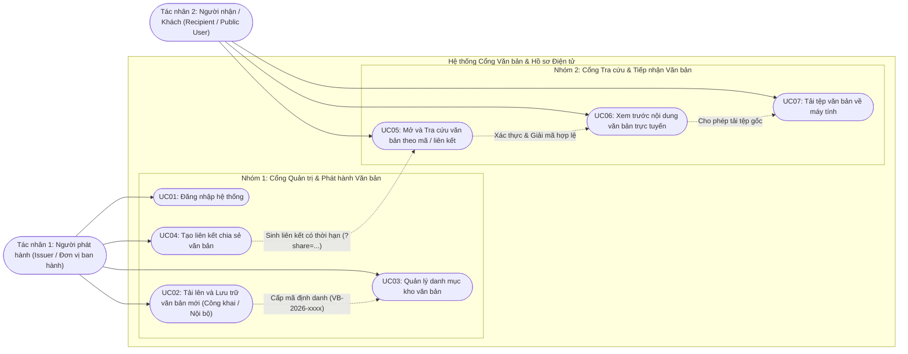
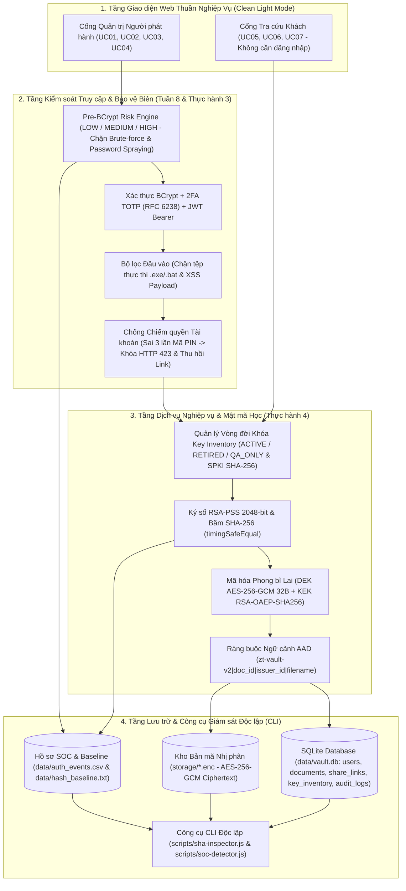
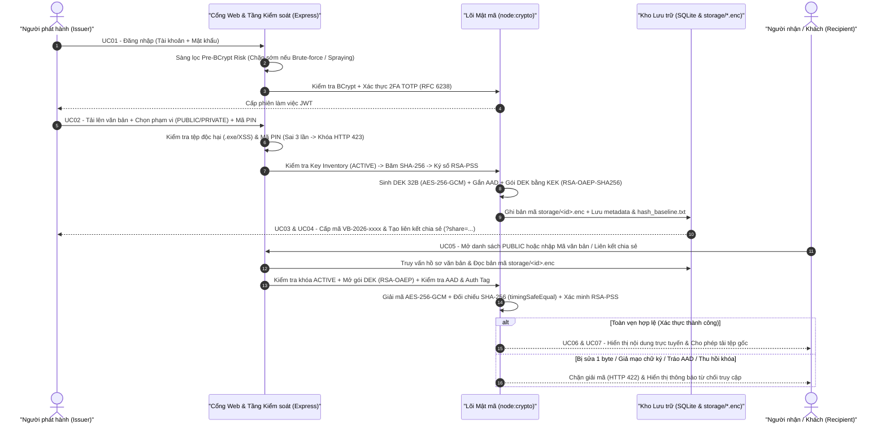

# Cổng Văn Bản & Hồ Sơ Điện Tử (Zero-Trust Document Vault)

> **Đồ án Cuối kỳ — Học phần: Bảo mật Mạng máy tính và Hệ thống**
> **Hướng tiếp cận:** Thiết kế phần mềm lưu trữ, phát hành và tra cứu văn bản điện tử đa tầng bảo mật
> **Nguyên lý cốt lõi:** *"Không phải mọi thông tin mà hệ thống nhận được đều đáng tin cậy — Mọi đầu vào, bản mã lưu trữ, khóa mật mã và phiên truy cập đều phải được kiểm chứng trước khi chấp nhận."*

---

## 1. Tổng Quan Hệ Thống Cổng Văn Bản & Hồ Sơ Điện Tử

Hệ thống được thiết kế như một **phần mềm quản lý, phát hành và tra cứu văn bản điện tử thuần nghiệp vụ** ở chế độ Sáng (**Clean Light Mode**). Giao diện Web tập trung hoàn toàn vào công việc văn phòng của người dùng (không phơi bày các thông số mật mã thô trên màn hình), trong khi toàn bộ cơ chế mật mã học, kiểm soát rủi ro và giám sát an ninh vận hành ngầm ở tầng Backend cùng bộ công cụ dòng lệnh (CLI) độc lập.

### 1.1. Hai Tác Nhân Phần Mềm (Actors)
1. **Người phát hành (Issuer / Đơn vị ban hành)**: Cán bộ quản lý (ví dụ: *Phòng Đào tạo*, *Phòng Kế hoạch Tài chính*) đăng nhập vào cổng làm việc để tải lên lưu trữ văn bản mới, chọn phạm vi văn bản (**Công khai** hoặc **Nội bộ**), quản lý danh mục kho văn bản đã ban hành và cấp liên kết chia sẻ có thời hạn.
2. **Người nhận / Khách (Recipient / Public User)**: Sinh viên, đối tác hoặc nhân sự truy cập Cổng tra cứu khách **không cần đăng nhập tài khoản** để xem danh sách văn bản công khai, tra cứu văn bản theo mã định danh hoặc liên kết chia sẻ, xem trước nội dung trực tuyến và tải tệp gốc về máy.

### 1.2. Bảng 7 Use Case Thuần Nghiệp Vụ (`UC01 -> UC07`)

| Mã UC | Tên Use Case | Tác nhân | Mô tả luồng nghiệp vụ chính |
| :--- | :--- | :--- | :--- |
| **UC01** | Đăng nhập hệ thống | Người phát hành | Cán bộ nhập tài khoản và mật khẩu để truy cập bảng điều khiển quản lý danh mục văn bản của đơn vị. |
| **UC02** | Tải lên và Lưu trữ văn bản mới | Người phát hành | Chọn tệp từ máy tính hoặc nhập nội dung, điền Tên văn bản, Cơ quan ban hành, chọn Phạm vi (`Công khai` / `Nội bộ`), nhập Mã xác nhận lưu trữ và bấm **Lưu trữ văn bản**; hệ thống cấp Mã định danh (`VB-2026-0001`, `VB-2026-0002`, ...). |
| **UC03** | Quản lý danh mục kho văn bản | Người phát hành | Xem bảng danh mục gồm: Mã định danh, Tên tệp, Cơ quan ban hành, Ngày ban hành, Kích thước, Phạm vi (`Công khai` / `Nội bộ`), Trạng thái phát hành (`Đã ban hành` / `Đang chia sẻ`) và lọc/tìm kiếm văn bản. |
| **UC04** | Tạo liên kết chia sẻ văn bản | Người phát hành | Chọn văn bản, thiết lập thời hạn hiệu lực (`15 phút`, `1 giờ`, `1 ngày`), sinh liên kết chia sẻ và sao chép gửi cho người nhận. |
| **UC05** | Mở và Tra cứu văn bản theo mã / liên kết | Người nhận / Khách | Bấm **Xem** trực tiếp tại bảng **Danh sách văn bản công khai**, hoặc nhập mã định danh (`VB-2026-0001`, `VB-2026-0002`) / liên kết chia sẻ (`?share=...`) vào thanh tra cứu. |
| **UC06** | Xem trước nội dung văn bản trực tuyến | Người nhận / Khách | Xem trực tiếp Mã định danh, Tên tệp, Cơ quan ban hành, Ngày ban hành, Kích thước và toàn bộ nội dung văn bản trên trình duyệt sau khi hệ thống xác thực tính toàn vẹn. |
| **UC07** | Tải tệp văn bản về máy tính | Người nhận / Khách | Bấm nút **Tải tệp về máy** tại khung xem trước để lưu tệp văn bản gốc về thiết bị cá nhân. |

### 1.3. Cơ Chế Phân Loại Văn Bản Công Khai (`PUBLIC`) & Nội Bộ (`PRIVATE`)
- **Văn bản Công khai (`PUBLIC`)**: Hiển thị trực tiếp tại bảng **Danh sách văn bản công khai** trên Cổng tra cứu khách (`GET /api/documents/public`) kèm bộ lọc nhanh (ví dụ mẫu khởi tạo sẵn: `VB-2026-0001` — `Quyet_Dinh_Cong_Nhan_Tot_Nghiep_2026.txt`).
- **Văn bản Nội bộ (`PRIVATE`)**: Ẩn hoàn toàn khỏi danh sách công khai trên Cổng tra cứu khách; chỉ có thể mở khi người nhận nhập đúng Mã định danh (`VB-2026-0002` — `Hop_Dong_Ngan_Sach_Noi_Bo_2026.txt`) hoặc mở bằng Liên kết chia sẻ hợp lệ (`GET /api/documents/lookup/:query`).

### 1.4. Sơ Đồ Use Case Tổng Thể (`UC01 -> UC07`)



---

## 2. Trả Lời Trực Diện 5 Câu Hỏi Cốt Lõi Của Đồ Án Bảo Mật Máy Tính & Hệ Thống

### Câu 1: Hệ thống đang bảo vệ tài sản hoặc dữ liệu gì?
- **Nội dung văn bản và hồ sơ điện tử** (quyết định công nhận tốt nghiệp, bảng điểm, hợp đồng ngân sách nội bộ) lưu trữ trong kho `storage/*.enc` (yêu cầu tính bí mật, toàn vẹn và sẵn sàng).
- **Khóa mật mã của đơn vị phát hành**: Khóa ký số bất đối xứng `RSA-2048`, khóa đóng gói `KEK` (`RSA-OAEP-SHA256`), khóa dữ liệu `DEK` (`AES-256-GCM` 32 bytes) và danh mục trạng thái khóa `key_inventory` (`data/key_inventory.csv`).
- **Danh tính tài khoản cán bộ phát hành, liên kết chia sẻ có thời hạn và nhật ký kiểm toán (`audit_logs`, `data/auth_events.csv`, `data/hash_baseline.txt`)**.

### Câu 2: Ai sử dụng hệ thống và ai có thể tấn công hoặc lợi dụng hệ thống?
- **Người sử dụng hợp lệ**:
  - **Người phát hành (Issuer)**: Cán bộ văn thư / quản lý ban hành và chia sẻ văn bản (`UC01 -> UC04`).
  - **Người nhận / Khách (Recipient)**: Sinh viên, đối tác, cán bộ tra cứu và tải văn bản (`UC05 -> UC07`).
- **Đối tượng tấn công / lợi dụng hệ thống**:
  - **Kẻ tấn công bên ngoài (External Attacker)**: Thực hiện vét cạn mật khẩu (Brute-force), rải mật khẩu trên nhiều tài khoản (Password Spraying), phát tán tệp thực thi độc hại `.exe` hoặc chèn mã kịch bản XSS giả mạo văn bản.
  - **Kẻ tấn công nội gián hoặc xâm nhập máy chủ (Malicious Insider / Compromised Host)**: Can thiệp sửa đổi byte trực tiếp trên tệp lưu trữ `storage/*.enc`, hoán đổi ngữ cảnh bản mã giữa các hồ sơ (Context-Swapping), ký đè văn bản bằng khóa giả mạo (`mallory_attacker`), hoặc lạm dụng khóa đã thu hồi (`RETIRED`).
  - **Kẻ chiếm quyền phiên làm việc (Session Hijacker)**: Đánh cắp phiên đăng nhập của cán bộ để phát hành văn bản giả hoặc phát tán liên kết chia sẻ trái phép.

### Câu 3: Những rủi ro hoặc cách tấn công nào có thể xảy ra?
1. **Tấn công can thiệp dữ liệu lưu trữ (Storage Tampering 1-byte)**: Sửa đổi 1 byte trong tệp mã hóa trên ổ đĩa hoặc tệp tải lên đối chiếu.
2. **Tấn công giả mạo chữ ký số (Signature Forgery)**: Ký đè văn bản bằng Private Key của kẻ mạo danh.
3. **Tấn công hoán đổi ngữ cảnh bản mã (Context-Swapping Attack)**: Đánh tráo bản mã hoặc thông tin định danh giữa hai hồ sơ văn bản.
4. **Lạm dụng khóa không còn hiệu lực (Key Lifecycle Violation)**: Sử dụng khóa đã thu hồi (`RETIRED`) hoặc khóa thử nghiệm (`QA_ONLY`) để ký/giải mã văn bản.
5. **Tấn công dò mật khẩu & làm cạn kiệt tài nguyên CPU (Brute-force & Password Spraying)**: Gửi hàng loạt yêu cầu đăng nhập sai làm quá tải hàm băm `BCrypt` hoặc vét cạn mã 2FA TOTP.
6. **Tấn công đầu vào giả mạo (Input Forgery / Malicious Upload)**: Tải lên tệp thực thi `.exe/.bat/.ps1` hoặc chèn mã độc `<script>` vào nội dung văn bản.
7. **Chiếm quyền tài khoản (Account Takeover) & Dùng lại liên kết chia sẻ hết hạn (Expired Link Replay)**.

### Câu 4: Hệ thống sử dụng cơ chế nào để bảo vệ?
- **Tầng Bảo vệ Đường truyền Mạng & Chống Soi API (`Zero-Trust Two-Way Encrypted Tunnel`)**: Mọi yêu cầu từ trình duyệt (`GET`, `POST`, `DELETE`) đều được đóng gói `{ method, path, body }`, mã hóa `AES-256-GCM` thành `ztEncryptedPayload` và gửi qua một cổng duy nhất `POST /api/zt-tunnel` kèm bộ 3 header chống phát lại (`X-ZT-Timestamp`, `X-ZT-Nonce`, `X-ZT-Signature` ký bằng `HMAC-SHA256` và đối chiếu bằng `crypto.timingSafeEqual()`); chiều phản hồi JSON từ máy chủ cũng được mã hóa `AES-256-GCM` thành `ztEncryptedResponse` (`<ivHex12B>.<ciphertextBase64>.<authTagHex16B>`), ẩn hoàn toàn đường dẫn API nghiệp vụ, mã văn bản và dữ liệu JSON trên tab `Network`/`Preview`/`Response` của F12 DevTools.
- **Tầng Mật mã học**: Mã hóa phong bì lai **Hybrid Envelope Encryption** (`DEK AES-256-GCM` 32 bytes ngẫu nhiên cho từng tệp + `KEK RSA-OAEP-SHA256`), ràng buộc ngữ cảnh **AAD (`Additional Authenticated Data`)**, băm **SHA-256** đối chiếu hằng thời gian `crypto.timingSafeEqual()`, chữ ký số **RSA-PSS 2048-bit**, và kiểm tra vòng đời khóa **Key Inventory** (`ACTIVE` / `RETIRED` / `QA_ONLY`) kèm dấu vân tay **SPKI SHA-256**.
- **Tầng Kiểm soát truy cập & SOC**: Sàng lọc rủi ro thích ứng **trước BCrypt (`Pre-BCrypt Risk Triage`)** chặn sớm Brute-force và Password Spraying, xác thực đa yếu tố **2FA TOTP (RFC 6238)**, kiểm tra **Mã xác nhận lưu trữ cấp 2 (Signing PIN)**, lọc đầu vào độc hại, và ghi vết chuẩn SOC (`data/auth_events.csv`, `data/hash_baseline.txt`).

### Câu 5: Nếu thông tin đầu vào bị giả mạo hoặc tài khoản bị chiếm quyền thì hệ thống xử lý như thế nào?
- **Khi gói tin đường truyền, thông tin đầu vào bị giả mạo (tệp `.exe`/script độc hại) hoặc bản mã/chữ ký/AAD/khóa bị can thiệp**:
  - Hệ thống chặn ngay gói tin sai chữ ký `HMAC-SHA256`, quá hạn thời gian hoặc phát lại `Nonce` (`HTTP 401` / `HTTP 409`), từ chối lưu trữ tệp độc hại (`HTTP 400 MALICIOUS_OR_FORGED_INPUT`) hoặc ngắt quá trình giải mã và chặn tải xuống (`HTTP 422 STORAGE_TAMPERED` / `SIGNATURE_FORGED` / `AAD_CONTEXT_MISMATCH` / `KEY_NOT_ACTIVE`), hiển thị thông báo từ chối truy cập trên giao diện và ghi nhận cảnh báo mức `CRITICAL` vào nhật ký kiểm toán.
- **Khi tài khoản bị chiếm quyền (Account Takeover — kẻ tấn công chiếm phiên và nhập sai Mã xác nhận lưu trữ 3 lần liên tiếp)**:
  - Hệ thống tự động kích hoạt **Khóa khẩn cấp tài khoản (`HTTP 423 ACCOUNT_COMPROMISED_LOCKED`)**, vô hiệu hóa toàn bộ quyền tải lên và chia sẻ của tài khoản đó, đồng thời **thu hồi tức thì mọi liên kết chia sẻ đang mở (`HTTP 403 LINK_REVOKED_ACCOUNT_TAKEOVER`)**.

---

## 3. Kiến Trúc Bảo Mật Đa Tầng (Đối Chiếu Học Phần `BAI_HOC`)

### 3.1. Sơ Đồ Cấu Trúc Hệ Thống & Bảo Mật Đa Tầng (System Architecture Diagram)



### 3.2. Sơ Đồ Trình Tự Luồng Phát Hành, Chia Sẻ & Tra Cứu Văn Bản (Sequence Diagram)



### 3.3. Tầng Mật Mã Học (Đối chiếu Bài Thực Hành 4)
1. **Mã hóa Phong bì Lai (`Hybrid Envelope Encryption` — `DEK` + `KEK`)**:
   - Sinh khóa đối xứng `DEK` (`AES-256-GCM`, 32 bytes) ngẫu nhiên độc lập cho từng văn bản cùng `IV` 12 bytes duy nhất và `Auth Tag` 16 bytes.
   - Đóng gói `DEK` bằng khóa công khai `KEK` của đơn vị phát hành với thuật toán `RSA-OAEP-SHA256` (`wrapped_dek_b64`), chỉ lưu bản mã nhị phân trong `storage/<id>.enc`.
2. **Dữ liệu Xác thực Bổ sung (`Additional Authenticated Data - AAD`)**:
   - Ràng buộc ngữ cảnh `zt-vault-v2|doc_id|issuer_id|original_filename` vào `cipher.setAAD()` / `decipher.setAAD()` (`aad_b64`), ngăn chặn triệt để hành vi đánh tráo bản mã giữa các hồ sơ (`HTTP 422 AAD_CONTEXT_MISMATCH`).
3. **Chữ ký số `RSA-PSS` 2048-bit & Đối chiếu `SHA-256` (`timingSafeEqual`)**:
   - Ký số trên bản rõ bằng `RSA-PSS` (`SHA-256`, độ dài salt 32 bytes) và so sánh mã băm bằng `crypto.timingSafeEqual()` để chống tấn công phân tích thời gian thực thi (Timing Side-Channel Attack).
4. **Quản lý Vòng đời Khóa (`Key Inventory`) & Dấu vân tay `SPKI SHA-256`**:
   - Duy trì bảng `key_inventory` và tệp `data/key_inventory.csv` lưu trữ mã định danh khóa (`key_id`), thuật toán, trạng thái vòng đời (`ACTIVE`, `RETIRED`, `QA_ONLY`) và dấu vân tay `fingerprint_sha256_spki`. Mọi yêu cầu giải mã/xác thực gắn với khóa `RETIRED` hoặc `QA_ONLY` đều bị chặn ngay (`HTTP 422 KEY_NOT_ACTIVE`).

### 3.4. Tầng Kiểm Soát Truy Cập, Bảo Vệ Đường Truyền & SOC (Đối chiếu Tuần 8 & Bài Thực Hành 3 SOC SHIFT)
1. **Đường hầm Mã hóa Hai chiều & Tăng cường Bảo mật 4 Lớp (`Zero-Trust 4-Layer Hardening`)**:
   - **Lớp 1 — Mã hóa & Làm mờ Chuỗi Endpoint (`Runtime String Obfuscation`)**: Xóa sạch 100% chuỗi đường dẫn dạng rõ (`/api/...`) khỏi mã nguồn Frontend (`0 match` khi quét grep), giải mã động qua bảng `XOR 0x5A + Hex` (`_ZT_ENDPOINTS`); đóng gói luôn cả tệp tải lên `FormData` thành Base64 `__ztFile` đi qua đường hầm.
   - **Lớp 2 — Chế độ Bắt buộc Đường hầm (`Strict Zero-Trust Tunnel Mode - 404 Blackhole`)**: Chỉ chấp nhận gói tin hợp lệ qua `POST /api/zt-tunnel` kèm chữ ký `HMAC-SHA256` (`X-ZT-Timestamp`, `X-ZT-Nonce`, `X-ZT-Signature`). Mọi truy vấn cố tình gọi thẳng vào các đường dẫn nghiệp vụ bên dưới đều trả về đồng nhất `HTTP 404 Not Found` (Blackhole).
   - **Lớp 3 — Lá chắn Chống Gỡ lỗi & Chống Mở DevTools (`Anti-DevTools & Anti-Hooking Shield`)**: Chặn phím tắt `F12`, `Ctrl+Shift+I/J/C`, `Ctrl+U` và chuột phải `contextmenu`; đóng băng `Object.freeze` các đối tượng mật mã/JSON và kích hoạt bẫy `debugger` bất đồng bộ.
   - **Lớp 4 — Tự động Khóa IP Chống Quét Từ điển (`Anti-Fuzzing Guard - HTTP 429`)**: Tự động khóa tạm thời địa chỉ IP bằng mã lỗi `HTTP 429 ANTI_FUZZING_BLOCKED` khi phát hiện từ 10 yêu cầu sai định dạng hoặc quét vào `404 Blackhole` trong vòng 1 phút.
   - **Mã hóa Chiều Phản hồi (`ztEncryptedResponse`)**: Toàn bộ phản hồi JSON từ máy chủ được mã hóa `AES-256-GCM` thành `{ ztEncryptedResponse: "<ivHex12B>.<ciphertextBase64>.<authTagHex16B>" }`.
2. **Xác thực Thích ứng Sàng lọc Trước BCrypt (`Pre-BCrypt Risk Triage`)**:
   - Đánh giá mức độ rủi ro (`LOW`, `MEDIUM`, `HIGH`) theo địa chỉ IP trong cửa sổ trượt 10 phút **trước khi** gọi `bcrypt.compareSync()`.
   - Tự động chặn ở mức `HIGH_RISK` (`HTTP 429 PRE_BCRYPT_BLOCKED`) khi phát hiện **Brute-force** (`>= 4` lần đăng nhập thất bại từ 1 IP) hoặc **Password Spraying** (`1 IP` thử sai mật khẩu trên `>= 3` tài khoản khác nhau), bảo vệ CPU không bị quá tải bởi hàm băm mật khẩu.
3. **Chống Chiếm Quyền Tài Khoản (`Account Takeover Lockout & Share Revocation`)**:
   - Yêu cầu Mã xác nhận lưu trữ cấp 2 (`Signing PIN`) khi phát hành văn bản; nhập sai 3 lần liên tiếp sẽ khóa khẩn cấp tài khoản (`HTTP 423`) và thu hồi toàn bộ liên kết chia sẻ đang hoạt động.
4. **Nhật ký Chuẩn CSV & Bộ Dò `SOC Detector` (`MITRE ATT&CK T1110`) + `Hash Baseline Drift`**:
   - Ghi nhận sự kiện xác thực theo định dạng chuẩn `timestamp,user,src_ip,event,asset,details` tại `data/auth_events.csv` và lưu danh sách mã băm chuẩn tại `data/hash_baseline.txt`.

---

## 4. Cấu Trúc Thư Mục Dự Án

```text
DACK/
├── src/
│   ├── crypto/
│   │   └── cryptoService.js       # Lõi mật mã: SHA-256, timingSafeEqual, RSA-PSS, Hybrid DEK/KEK RSA-OAEP, AES-256-GCM + AAD, SPKI Fingerprint, TOTP
│   ├── db/
│   │   └── database.js            # Quản lý SQLite (users, documents, share_links, audit_logs, key_inventory) & xuất CSV/Baseline
│   ├── middleware/
│   │   ├── authMiddleware.js      # Kiểm tra JWT Bearer Token
│   │   ├── payloadProtection.js   # Đường hầm mã hóa 2 chiều (POST /api/zt-tunnel + ztEncryptedResponse AES-256-GCM) & Chống Replay HMAC-SHA256
│   │   └── uploadMiddleware.js    # Kiểm tra biên kích thước tệp (0 byte < size <= 10MB)
│   ├── routes/
│   │   ├── authRoutes.js          # Pre-BCrypt Risk Triage (Brute-force/Spraying), BCrypt, 2FA TOTP, Account Status
│   │   └── documentRoutes.js      # Phân loại PUBLIC/PRIVATE, Ký số, Mã hóa phong bì lai, Tra cứu, Tải tệp & Chia sẻ
│   ├── utils/
│   │   └── docExtractor.js        # Trích xuất nội dung xem trước HTML/Text từ tệp Word (.docx)
│   └── app.js                     # Khởi tạo ứng dụng Express nguyên khối
├── public/
│   ├── index.html                 # Giao diện Cổng Văn bản & Hồ sơ Điện tử (Clean Light Mode, 2 Actors, UC01 -> UC07)
│   ├── styles.css                 # Bảng màu sáng chuẩn ứng dụng hành chính/doanh nghiệp
│   └── app.js                     # Xử lý luồng nghiệp vụ & protectedFetch() mã hóa hai chiều qua /api/zt-tunnel
├── scripts/
│   ├── sha-inspector.js           # Công cụ CLI đối chiếu SHA-256, Hash Baseline Drift, Hybrid Envelope & Key Inventory
│   └── soc-detector.js            # Công cụ CLI phân tích data/auth_events.csv theo MITRE ATT&CK T1110 (SOC SHIFT)
├── tests/
│   ├── security.test.js           # Bộ kiểm thử tự động 28 bài (1 Unit Crypto + 27 ca TC01 -> TC27)
│   └── ui-e2e-capture.js          # Kịch bản kiểm thử giao diện tự động & chụp ảnh nghiệm thu (1440x900)
├── data/
│   ├── vault.db                   # Cơ sở dữ liệu SQLite cục bộ
│   ├── key_inventory.csv          # Danh mục vòng đời khóa KEK & SPKI SHA-256 Fingerprint
│   ├── auth_events.csv            # Nhật ký sự kiện xác thực chuẩn SOC SHIFT
│   └── hash_baseline.txt          # Bản ghi đối chiếu mã băm SHA-256 gốc (Baseline)
├── storage/                       # Kho lưu trữ tệp nhị phân đã mã hóa AES-256-GCM (*.enc)
├── BAO_CAO_DO_AN.md               # Báo cáo tổng hợp đặc tả Use Case, kiến trúc bảo mật & ma trận 28 ca kiểm thử
├── HUONG_DAN_DEMO.md              # Hướng dẫn thao tác trình diễn trên giao diện Web, DevTools Network & CLI
├── server.js                      # Điểm khởi chạy máy chủ tại cổng 3000
└── package.json                   # Cấu hình scripts và dependencies
```

---

## 5. Hướng Dẫn Cài Đặt, Khởi Chạy & Bộ Lệnh Công Cụ Dòng Lệnh (CLI)

### 5.1. Cài đặt & Khởi chạy Phần mềm Web
Yêu cầu **Node.js `v22.5.0` trở lên** (khuyến nghị `v24.x` LTS để sử dụng mô-đun tích hợp `node:sqlite` và `node:crypto`).

```bash
# 1. Cài đặt thư viện phụ thuộc
npm install

# 2. Khởi chạy máy chủ Web tại cổng 3000
npm start
```

Mở trình duyệt truy cập: **`http://localhost:3000`**

- **Tài khoản Cán bộ phát hành mặc định (`UC01`)**:
  - Tài khoản: `issuer_admin`
  - Mật khẩu: `Admin@123`
  - Mã xác nhận lưu trữ (`UC02`): `UIT-SIGN-2026`
- **Hai văn bản khởi tạo tự động khi chạy lần đầu**:
  - `VB-2026-0001` (`Quyet_Dinh_Cong_Nhan_Tot_Nghiep_2026.txt`) — Phạm vi: **Công khai (`PUBLIC`)** (hiển thị ngay tại bảng *Danh sách văn bản công khai*).
  - `VB-2026-0002` (`Hop_Dong_Ngan_Sach_Noi_Bo_2026.txt`) — Phạm vi: **Nội bộ (`PRIVATE`)** (ẩn khỏi bảng công khai, chỉ mở được khi nhập mã `VB-2026-0002` hoặc liên kết chia sẻ vào ô tra cứu).

---

### 5.2. Bộ Lệnh Công Cụ Dòng Lệnh Ngoài (External Inspection & SOC CLI)

1. **Kiểm tra mã băm `SHA-256`, đối chiếu `hash_baseline.txt`, Phong bì lai `DEK/KEK` và `key_inventory.csv`**:
   ```bash
   npm run tool:sha
   ```
   *(Có thể truyền đường dẫn tệp bất kỳ để đối chiếu độc lập với kho lưu trữ: `node scripts/sha-inspector.js <duong_dan_tep>`).*

2. **Đối chiếu mã băm `SHA-256` độc lập bằng công cụ có sẵn của Hệ điều hành**:
   ```powershell
   # Trên Windows PowerShell:
   Get-FileHash .\data\hash_baseline.txt -Algorithm SHA256

   # Trên Windows Command Prompt (CMD):
   certutil -hashfile .\data\hash_baseline.txt SHA256
   ```

3. **Phân tích nhật ký xác thực `data/auth_events.csv` bằng Bộ dò SOC (`MITRE ATT&CK T1110`)**:
   ```bash
   npm run tool:soc
   ```
   *(Phát hiện các nguồn IP tấn công Brute-force `>= 4` lần sai, Password Spraying `>= 3` tài khoản trong cửa sổ 10 phút và trạng thái chặn sớm `PRE_BCRYPT_BLOCKED`).*

---

### 5.3. Kiểm Chứng Đường Hầm Mã Hóa Hai Chiều Trên DevTools (F12 Network)

Mở công cụ **Developer Tools (`F12`) -> Tab `Network` -> Lọc `Fetch/XHR`** trên trình duyệt khi thao tác tại `http://localhost:3000`:
- Toàn bộ yêu cầu tải danh mục, tra cứu mã văn bản, đăng nhập hay xóa văn bản đều chỉ hiển thị dưới tên **`zt-tunnel`** (`POST /api/zt-tunnel`).
- **Tab `Headers`**: Hiển thị đầy đủ các header bảo vệ đường truyền `X-ZT-Encrypted: AES-256-GCM`, `X-ZT-Timestamp`, `X-ZT-Nonce`, `X-ZT-Signature` (chiều gửi) và `X-ZT-Verified-Request: HMAC-SHA256-OK`, `X-ZT-Tunnel-Routed: AES-256-GCM-TUNNEL-OK`, `X-ZT-Response-Encrypted: AES-256-GCM` (chiều nhận).
- **Tab `Payload` (Request Body)**: Chỉ chứa bản mã `{"ztEncryptedPayload": "<ivHex>.<ciphertextBase64>.<authTagHex>"}`.
- **Tab `Preview` / `Response` (Response Body)**: Chỉ chứa bản mã `{"ztEncryptedResponse": "<ivHex>.<ciphertextBase64>.<authTagHex>"}`, hoàn toàn không lộ dữ liệu JSON nghiệp vụ dạng rõ trên công cụ theo dõi mạng.

---

### 5.4. Chạy Bộ Kiểm Thử Bảo Mật Tự Động (`28/28` Ca Nghiệm Thu Đạt)

```bash
npm test
```
