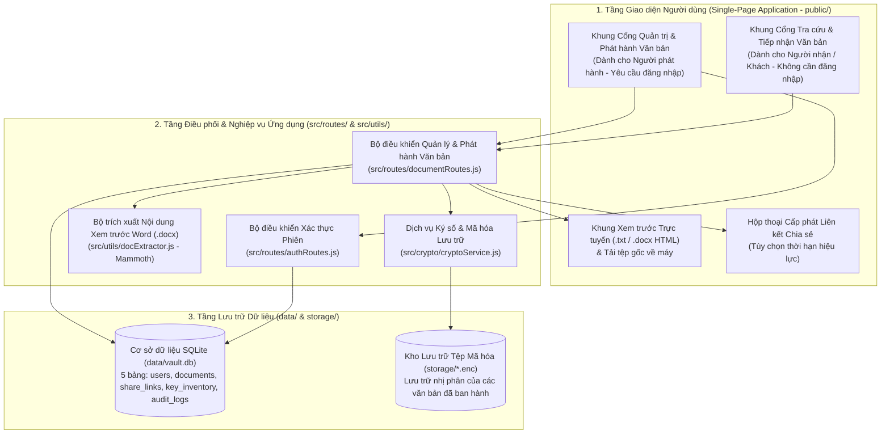
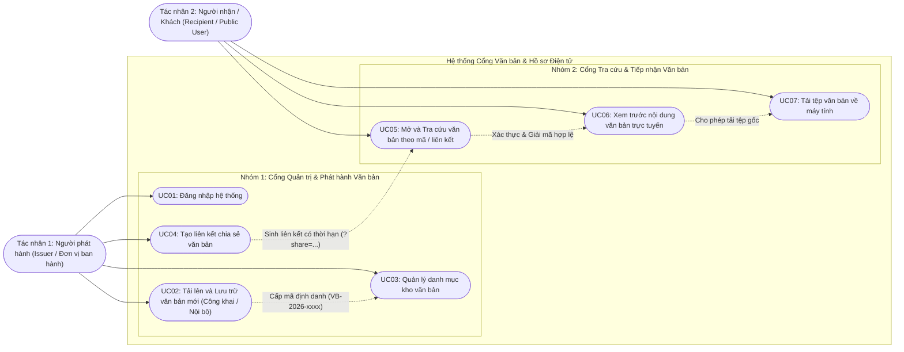
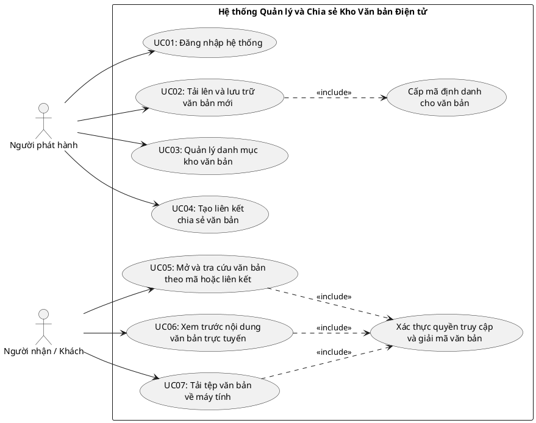
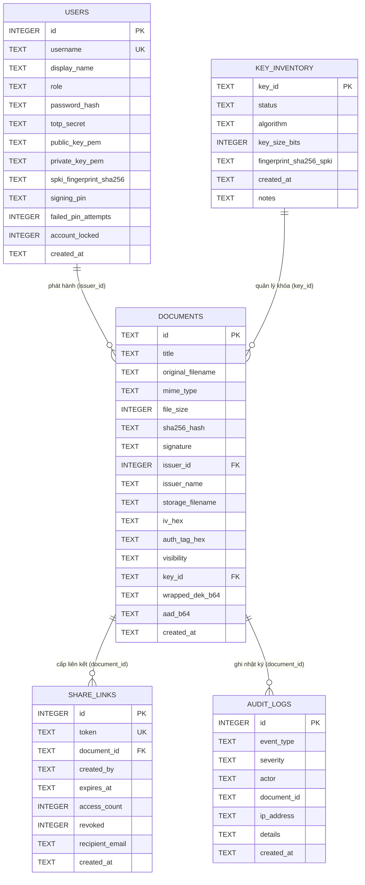

# Tài Liệu Phần Mềm — Hệ Thống Cổng Văn Bản & Hồ Sơ Điện Tử

> **Tài liệu Đặc tả Phần mềm, Phân quyền Vai trò, Cơ sở Dữ liệu & Hướng dẫn Vận hành Nghiệp vụ**
> *(Xem thêm: [README.md](file:///D:/University/Y4-5%20Bao%20Mat%20May%20Tinh%20Va%20HT/DACK/README.md) để cài đặt hệ thống | [PHUONG_PHAP_BAO_MAT.md](file:///D:/University/Y4-5%20Bao%20Mat%20May%20Tinh%20Va%20HT/DACK/PHUONG_PHAP_BAO_MAT.md) để xem chi tiết giải pháp mật mã học và hệ thống phòng thủ 4 lớp).*

---

## 1. Kiến Trúc Ứng Dụng Phần Mềm & Nguyên Tắc Thiết Kế Giao Diện

### 1.1. Định hướng Phần mềm Thuần Nghiệp vụ (`Clean Light Mode`)
Hệ thống Cổng Văn bản & Hồ sơ Điện tử được thiết kế như một phần mềm hành chính — văn phòng thực thụ:
- Giao diện người dùng sử dụng tông màu sáng chuẩn doanh nghiệp (**Clean Light Mode**), tập trung 100% vào luồng công việc của cán bộ phát hành và người tra cứu văn bản.
- Không hiển thị các tham số kỹ thuật mật mã thô (như chuỗi băm `SHA-256`, `IV 12B`, `Auth Tag 16B`) hay thanh công cụ giả lập tấn công trên màn hình Web. Mọi bước kiểm tra chữ ký số, đối chiếu mã băm, mở gói khóa phong bì lai và giải mã đều diễn ra tự động ở tầng dịch vụ phía sau.

### 1.2. Sơ Đồ Kiến Trúc Tổng Thể Ứng Dụng Phần Mềm

---

## 2. Mô Hình Phân Quyền Vai Trò (`Actors`) & Phân Loại Phạm Vi Văn Bản

### 2.1. Hai Tác nhân Phần mềm (`Actors`) và Ma trận Phân quyền

1. **Người phát hành (`Issuer` / Đơn vị ban hành)**:
   - Là cán bộ văn thư, phòng ban quản lý (ví dụ: *Phòng Đào tạo*, *Phòng Kế hoạch Tài chính*) được cấp tài khoản định danh cùng cặp khóa mật mã và Mã xác nhận lưu trữ (`Signing PIN`).
   - Có quyền đăng nhập hệ thống, tải lên và phát hành văn bản mới, thiết lập phạm vi hiển thị (`Công khai` hoặc `Nội bộ`), xem toàn bộ danh mục kho văn bản, tạo liên kết chia sẻ có thời hạn và xóa văn bản khỏi kho.
2. **Người nhận / Khách (`Recipient` / `Public User`)**:
   - Là sinh viên, giảng viên, đối tác hoặc nhân sự truy cập vào cổng tra cứu mà **không cần đăng nhập tài khoản**.
   - Có quyền duyệt danh sách các văn bản công khai, tìm kiếm nhanh theo từ khóa, tra cứu văn bản nội bộ hoặc công khai bằng Mã định danh (`VB-2026-xxxx`) hoặc Liên kết chia sẻ (`?share=...`), xem trước nội dung văn bản trực tuyến và tải tệp gốc về thiết bị cá nhân.

| Chức năng phần mềm | Người phát hành (`Issuer`) | Người nhận / Khách (`Recipient / Public`) | Điều kiện kiểm soát quyền |
| :--- | :---: | :---: | :--- |
| Xem danh sách văn bản Công khai (`PUBLIC`) | Có | Có | Mở tự do trên trang chủ, không yêu cầu đăng nhập |
| Xem danh sách toàn bộ kho (`PUBLIC` + `PRIVATE`) | Có | Không | Yêu cầu phiên đăng nhập `JWT Bearer` hợp lệ |
| Tra cứu văn bản `PRIVATE` qua Mã định danh / Link | Có | Có | Phải cung cấp đúng mã `VB-2026-xxxx` hoặc `token` chia sẻ còn hạn |
| Xem trước nội dung trực tuyến & Tải tệp gốc | Có | Có | Văn bản phải vượt qua bước xác thực tính toàn vẹn & chữ ký số |
| Đăng nhập quản trị & Xác thực 2FA (`UC01`) | Có | Không | Yêu cầu đúng mật khẩu `BCrypt` và mã `TOTP` 6 số |
| Tải lên & Phát hành văn bản mới (`UC02`) | Có | Không | Yêu cầu phiên `JWT` + nhập đúng Mã xác nhận lưu trữ (`Signing PIN`) |
| Tạo liên kết chia sẻ có thời hạn (`UC04`) | Có | Không | Yêu cầu phiên `JWT` và tài khoản không bị khóa khẩn cấp |
| Xóa văn bản khỏi kho lưu trữ | Có | Không | Yêu cầu phiên `JWT` của cán bộ quản trị |

### 2.2. Cơ chế Phân loại Văn bản Công khai (`PUBLIC`) và Nội bộ (`PRIVATE`)
- **Văn bản Công khai (`PUBLIC`)**:
  - Dùng cho các thông báo, quy chế, quyết định chung (ví dụ: `VB-2026-0001` — `Quyet_Dinh_Cong_Nhan_Tot_Nghiep_2026.txt`).
  - Xuất hiện trực tiếp tại bảng **Danh sách văn bản công khai** trên Cổng tra cứu khách để người dùng mở xem hoặc tải về ngay bằng một cú nhấp chuột.
- **Văn bản Nội bộ (`PRIVATE`)**:
  - Dùng cho các hợp đồng, dự toán ngân sách, công văn giới hạn người xem (ví dụ: `VB-2026-0002` — `Hop_Dong_Ngan_Sach_Noi_Bo_2026.txt`).
  - Bị lọc ẩn hoàn toàn khỏi danh sách công khai trên Cổng tra cứu khách; chỉ những người nhận được cấp Mã định danh văn bản hoặc Liên kết chia sẻ hợp lệ mới có thể tra cứu và mở văn bản.

---

## 3. Đặc Tả Chi Tiết 7 Use Case Nghiệp Vụ (`UC01 -> UC07`)

### 3.1. Bảng Tóm tắt 7 Use Case Nghiệp vụ

| Mã UC | Tên Use Case | Tác nhân chính | Đầu vào nghiệp vụ | Kết quả đầu ra |
| :--- | :--- | :--- | :--- | :--- |
| **UC01** | **Đăng nhập hệ thống** | Người phát hành | Tài khoản (`username`), Mật khẩu (`password`) và mã xác thực 2FA TOTP | Mở bảng điều khiển Quản trị & Phát hành văn bản kèm phiên làm việc `JWT`. |
| **UC02** | **Tải lên và Lưu trữ văn bản mới** | Người phát hành | Tệp văn bản (hoặc nội dung soạn thảo), Tên văn bản, Cơ quan ban hành, Phạm vi (`PUBLIC`/`PRIVATE`), Mã xác nhận lưu trữ (`Signing PIN`) | Văn bản được ký số, mã hóa lưu vào `storage/*.enc`, ghi vào CSDL và cấp Mã định danh `VB-2026-xxxx`. |
| **UC03** | **Quản lý danh mục kho văn bản** | Người phát hành | Từ khóa tìm kiếm / bộ lọc danh mục của đơn vị | Hiển thị bảng danh mục đầy đủ gồm: Mã định danh, Tên tệp, Cơ quan ban hành, Ngày ban hành, Kích thước, Phạm vi, Trạng thái phát hành (`Đã ban hành` / `Đang chia sẻ`). |
| **UC04** | **Tạo liên kết chia sẻ văn bản** | Người phát hành | Văn bản được chọn và thời hạn hiệu lực (`15 phút`, `1 giờ`, `1 ngày`, `7 ngày`, `30 ngày`, `90 ngày`, `1 năm`) | Sinh mã liên kết chia sẻ (`?share=<token>`) kèm nút sao chép nhanh để gửi cho người nhận. |
| **UC05** | **Mở và Tra cứu văn bản theo mã / liên kết** | Người nhận / Khách | Chọn từ bảng công khai hoặc nhập mã định danh (`VB-2026-xxxx`) / liên kết chia sẻ vào ô tra cứu | Hệ thống tìm hồ sơ, kiểm tra thời hạn, xác thực chữ ký & giải mã văn bản để trả về kết quả tra cứu. |
| **UC06** | **Xem trước nội dung văn bản trực tuyến** | Người nhận / Khách | Hồ sơ văn bản đã được xác thực hợp lệ từ `UC05` | Hiển thị thông tin siêu dữ liệu (Mã văn bản, Tên tệp, Cơ quan ban hành, Ngày ban hành, Kích thước) và toàn bộ nội dung văn bản (văn bản thuần hoặc kết xuất HTML từ `.docx`). |
| **UC07** | **Tải tệp văn bản về máy tính** | Người nhận / Khách | Thao tác bấm nút **Tải tệp về máy** tại khung xem trước | Trình duyệt tải xuống tệp văn bản gốc nguyên vẹn 100% định dạng và tên tệp ban đầu. |

### 3.2. Sơ Đồ Use Case Tổng Thể

#### a) Sơ đồ Use Case theo chuẩn Mermaid (`flowchart LR`)

#### b) Sơ đồ Use Case theo chuẩn PlantUML (`@startuml`)

### 3.3. Đặc tả Luồng Sự kiện Chi tiết của Từng Use Case

1. **UC01 — Đăng nhập hệ thống**:
   - **Điều kiện tiên quyết**: Người dùng đang ở chế độ Khách và bấm nút `Đăng nhập Cán bộ phát hành` trên thanh tiêu đề.
   - **Luồng chính**:
     1. Cán bộ nhập `Tài khoản` và `Mật khẩu` vào hộp thoại đăng nhập và bấm `Đăng nhập`.
     2. Giao diện tự động tính mã xác thực hai yếu tố `TOTP` (6 chữ số theo chuẩn RFC 6238) và hoàn tất bước xác thực 2FA với máy chủ.
     3. Hệ thống cấp phát `JWT Token`, chuyển giao diện sang khu vực **Cổng Quản trị & Phát hành Văn bản** và tải danh mục kho văn bản của đơn vị.
   - **Luồng ngoại lệ**: Nếu nhập sai mật khẩu hoặc vượt ngưỡng đăng nhập sai liên tiếp, hệ thống hiển thị thông báo từ chối đăng nhập.

2. **UC02 — Tải lên và Lưu trữ văn bản mới**:
   - **Điều kiện tiên quyết**: Cán bộ phát hành đã đăng nhập thành công (`UC01`).
   - **Luồng chính**:
     1. Cán bộ bấm nút `+ Tải lên văn bản mới`.
     2. Chọn tệp văn bản từ máy tính (`.txt`, `.docx`, `.pdf`, `.csv`, `.json`, `.md` với dung lượng `0 byte < size <= 10MB`) hoặc nhập trực tiếp nội dung văn bản vào khung soạn thảo. Khi chọn tệp `.docx` hoặc `.txt`, hệ thống tự động trích xuất nội dung hiển thị lên khung xem trước.
     3. Điền `Tên văn bản`, `Cơ quan ban hành`, chọn **Phạm vi văn bản** (`Công khai` hoặc `Nội bộ`) và nhập `Mã xác nhận lưu trữ` (`Signing PIN`).
     4. Bấm nút `Lưu trữ văn bản`. Hệ thống kiểm tra tính hợp lệ, thực hiện ký số, mã hóa lưu kho và cấp mã định danh tuần tự (`VB-2026-0003`, ...).
   - **Luồng ngoại lệ**: Nếu tải tệp rỗng (`0 byte`), tệp quá `10MB`, tệp thực thi nguy hiểm (`.exe`, `.bat`, `.ps1`) hoặc nhập sai `Mã xác nhận lưu trữ`, hệ thống từ chối lưu trữ và thông báo rõ nguyên nhân.

3. **UC03 — Quản lý danh mục kho văn bản**:
   - **Điều kiện tiên quyết**: Cán bộ phát hành đang ở màn hình quản trị.
   - **Luồng chính**:
     1. Hệ thống hiển thị bảng danh mục toàn bộ văn bản (`PUBLIC` và `PRIVATE`) với đầy đủ thông tin: Mã định danh, Tên tệp, Cơ quan ban hành, Ngày ban hành, Kích thước, Phạm vi, Trạng thái phát hành (`Đã ban hành` hoặc `Đang chia sẻ`).
     2. Cán bộ có thể gõ từ khóa vào ô tìm kiếm để lọc nhanh theo mã văn bản, tên tệp hoặc đơn vị ban hành; hoặc thực hiện các thao tác `Chia sẻ`, `Xem`, `Xóa` trên từng dòng văn bản.

4. **UC04 — Tạo liên kết chia sẻ văn bản**:
   - **Điều kiện tiên quyết**: Cán bộ chọn một văn bản trong kho (`UC03`) hoặc vừa lưu trữ xong văn bản mới (`UC02`).
   - **Luồng chính**:
     1. Cán bộ bấm nút `Chia sẻ` tại dòng văn bản cần cấp quyền.
     2. Chọn thời hạn hiệu lực của liên kết chia sẻ (`15 phút`, `1 giờ`, `1 ngày`, `7 ngày`, `30 ngày`, `90 ngày` hoặc `1 năm`) và bấm `Tạo liên kết chia sẻ`.
     3. Hệ thống sinh chuỗi đường dẫn chia sẻ có dạng `http://localhost:3000/?share=<token>` và cập nhật trạng thái văn bản sang `Đang chia sẻ`. Cán bộ bấm `Sao chép liên kết` để gửi cho người nhận.

5. **UC05 — Mở và Tra cứu văn bản theo mã / liên kết**:
   - **Điều kiện tiên quyết**: Người nhận / Khách truy cập trang chủ Cổng tra cứu (không cần đăng nhập).
   - **Luồng chính**:
     1. Người nhận có 3 cách mở văn bản:
        - Cách 1: Bấm nút `Xem` tại một văn bản trong bảng **Danh sách văn bản công khai**.
        - Cách 2: Nhập mã định danh (ví dụ `VB-2026-0001` hoặc mã nội bộ `VB-2026-0002`) vào thanh tra cứu và bấm `Tra cứu văn bản`.
        - Cách 3: Dán liên kết chia sẻ (hoặc mở trực tiếp URL có tham số `?share=<token>`) vào trình duyệt.
     2. Hệ thống xác thực chữ ký số, kiểm tra tính toàn vẹn của bản mã lưu trữ và giải mã nội dung văn bản để chuyển sang màn hình xem trước (`UC06`).
   - **Luồng ngoại lệ**: Nếu liên kết chia sẻ đã hết hạn, bị thu hồi, hoặc văn bản trong kho bị phát hiện can thiệp trái phép, hệ thống từ chối giải mã và hiển thị cảnh báo bảo mật màu đỏ.

6. **UC06 — Xem trước nội dung văn bản trực tuyến**:
   - **Điều kiện tiên quyết**: Văn bản đã được tra cứu và xác thực hợp lệ ở `UC05`.
   - **Luồng chính**:
     1. Giao diện hiển thị khung thông báo trạng thái xác thực hợp lệ (màu xanh) kèm bảng thông tin siêu dữ liệu của văn bản.
     2. Khung đọc văn bản trực tuyến hiển thị toàn bộ nội dung văn bản thuần hoặc nội dung định dạng đoạn văn/bảng biểu được trích xuất từ tệp Word (`.docx`).

7. **UC07 — Tải tệp văn bản về máy tính**:
   - **Điều kiện tiên quyết**: Văn bản đang được mở tại khung xem trước (`UC06`) hoặc người dùng bấm nút tải tại danh sách văn bản.
   - **Luồng chính**:
     1. Người nhận bấm nút `Tải tệp về máy`.
     2. Hệ thống khởi tạo đối tượng `Blob` từ luồng byte gốc đã được giải mã và xác thực, tự động kích hoạt trình tải xuống của trình duyệt với đúng tên tệp gốc ban đầu.

---

## 4. Thiết Kế Cơ Sở Dữ Liệu (`SQLite` — `data/vault.db`)

Hệ thống sử dụng cơ sở dữ liệu quan hệ nhúng **SQLite (`node:sqlite`)** lưu tại `data/vault.db` với ràng buộc khóa ngoại (`PRAGMA foreign_keys = ON`) gồm 5 bảng chính:

### 4.1. Sơ Đồ Thực Thể Liên Kết (ER Diagram)

### 4.2. Mô tả Chi tiết Các Bảng Dữ liệu và Tệp Đồng bộ

1. **Bảng `users`**: Lưu thông tin tài khoản cán bộ phát hành, mật khẩu băm `BCrypt`, khóa bí mật `totp_secret`, cặp khóa `RSA-2048`, dấu vân tay `spki_fingerprint_sha256`, mã xác nhận lưu trữ `signing_pin`, số lần nhập sai PIN liên tiếp (`failed_pin_attempts`) và cờ khóa khẩn cấp tài khoản (`account_locked`).
2. **Bảng `documents`**: Lưu siêu dữ liệu của từng hồ sơ văn bản, phạm vi hiển thị `visibility` (`PUBLIC` / `PRIVATE`), tên tệp mã hóa trong kho (`storage_filename`), mã băm `sha256_hash`, chữ ký số `signature`, tham số mã hóa phong bì lai (`key_id`, `wrapped_dek_b64`, `iv_hex`, `auth_tag_hex`) và ngữ cảnh xác thực bổ sung (`aad_b64`).
3. **Bảng `share_links`**: Quản lý các liên kết chia sẻ văn bản với mã `token` ngẫu nhiên duy nhất, thời điểm hết hạn `expires_at`, số lượt mở `access_count` và cờ thu hồi `revoked` (tự động chuyển thành `1` nếu tài khoản người phát hành bị khóa khẩn cấp).
4. **Bảng `key_inventory`** *(đồng bộ tự động ra `data/key_inventory.csv`)*: Quản lý danh mục vòng đời khóa đóng gói (`ACTIVE`, `RETIRED`, `QA_ONLY`) và dấu vân tay `fingerprint_sha256_spki`.
5. **Bảng `audit_logs`** *(đồng bộ sự kiện xác thực ra `data/auth_events.csv` và mã băm gốc ra `data/hash_baseline.txt`)*: Ghi nhận toàn bộ lịch sử đăng nhập, phát hành, tra cứu, chia sẻ, xóa văn bản và các cảnh báo vi phạm an ninh.

---

## 5. Hướng Dẫn Thao Tác Sử Dụng Giao Diện Phần Mềm

Sau khi khởi động máy chủ bằng lệnh `npm start` và mở trình duyệt tại **`http://localhost:3000`**, người dùng thực hiện theo 2 kịch bản tương ứng với 2 vai trò:

### 5.1. Kịch bản 1 — Dành cho Người nhận / Khách (`UC05 -> UC07`, Không cần đăng nhập)

1. **Duyệt danh sách văn bản công khai**:
   - Ngay tại màn hình chính, quan sát bảng **Danh sách văn bản công khai**. Hệ thống hiển thị sẵn văn bản mẫu `VB-2026-0001` (`Quyet_Dinh_Cong_Nhan_Tot_Nghiep_2026.txt`). Văn bản nội bộ `VB-2026-0002` được ẩn hoàn toàn khỏi bảng này.
   - Có thể nhập từ khóa vào ô **Tìm nhanh trong danh sách công khai** để lọc theo tên hoặc mã văn bản.
2. **Tra cứu và Mở văn bản (`UC05`)**:
   - **Thao tác mở văn bản công khai**: Bấm trực tiếp nút **`Xem`** ở dòng `VB-2026-0001`.
   - **Thao tác tra cứu văn bản nội bộ bằng mã**: Nhập mã **`VB-2026-0002`** vào ô nhập *Nhập Mã định danh văn bản hoặc dán Liên kết chia sẻ* ở phía trên và bấm nút **`Tra cứu văn bản`**.
3. **Xem trước nội dung trực tuyến (`UC06`) và Tải tệp gốc (`UC07`)**:
   - Quan sát khung kết quả hiển thị trạng thái xác thực hợp lệ màu xanh cùng đầy đủ thông tin: Mã định danh, Tên tệp, Cơ quan ban hành, Ngày ban hành, Kích thước và toàn bộ nội dung văn bản bên trong khung đọc trực tuyến.
   - Bấm nút **`Tải tệp về máy`** ở góc phải khung xem trước để lưu tệp văn bản gốc về máy tính.

### 5.2. Kịch bản 2 — Dành cho Người phát hành / Đơn vị ban hành (`UC01 -> UC04`)

1. **Đăng nhập vào Cổng Quản trị (`UC01`)**:
   - Bấm nút **`Đăng nhập Cán bộ phát hành`** ở góc trên bên phải màn hình.
   - Nhập Tài khoản: `issuer_admin` và Mật khẩu: `Admin@123`, sau đó bấm **`Đăng nhập`**.
2. **Quản lý danh mục kho văn bản (`UC03`)**:
   - Sau khi đăng nhập, màn hình hiển thị bảng **Danh mục Kho văn bản đã ban hành** bao gồm cả văn bản `Công khai` (`VB-2026-0001`) và văn bản `Nội bộ` (`VB-2026-0002`).
   - Sử dụng ô tìm kiếm phía trên bảng để lọc nhanh hồ sơ trong kho.
3. **Tải lên và Lưu trữ văn bản mới (`UC02`)**:
   - Bấm nút **`+ Tải lên văn bản mới`** để mở biểu mẫu phát hành.
   - Kéo thả hoặc chọn một tệp văn bản từ máy tính (`.txt`, `.docx`, `.pdf`...) hoặc nhập nội dung trực tiếp vào ô nội dung.
   - Điền **Tên văn bản**, kiểm tra **Cơ quan ban hành**, chọn **Phạm vi văn bản** (`Công khai` hoặc `Nội bộ`), nhập **Mã xác nhận lưu trữ** là `UIT-SIGN-2026` và bấm **`Lưu trữ văn bản`**.
   - Văn bản mới sẽ xuất hiện ngay trong bảng danh mục kèm mã định danh mới (`VB-2026-0003`).
4. **Tạo liên kết chia sẻ có thời hạn (`UC04`)**:
   - Tại dòng văn bản bất kỳ trong bảng danh mục, bấm nút **`Chia sẻ`**.
   - Chọn thời hạn hiệu lực mong muốn (`15 phút`, `1 giờ`, `1 ngày`, `7 ngày`, `30 ngày`, `90 ngày`, `1 năm`) và bấm **`Tạo liên kết chia sẻ`**.
   - Bấm **`Sao chép liên kết`** và dán liên kết đó vào thanh tra cứu (hoặc mở trên một cửa sổ trình duyệt mới) để kiểm chứng luồng mở văn bản qua liên kết chia sẻ.
